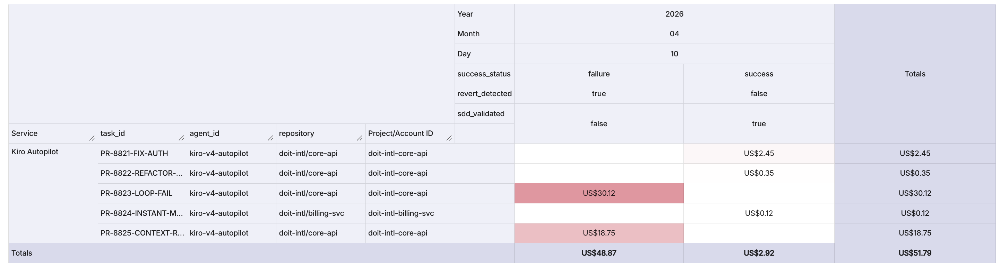

--- 
title: "Mastering Engineering Unit Economics: Tracking CPST and Token Waste with Kiro and DoiT"
social:
  name: Dr Richard Kang
  links:
    - https://www.linkedin.com/in/kangks/
---

## Overview: The Business "Why" of Agentic Unit Economics

I have been working with a high-performing engineering team recently that made the transition from simple autocomplete features to full-fledged agentic workflows using Kiro. By adopting agentic coding, they effectively force-multiplied their output, allowing autonomous agents to plan, reason, and execute complex changes across their entire repository. This shift is a remarkable milestone in the industrialisation of software; however, as an engineering leader and AWS Ambassador, I am frequently asked: “What is the real cost of this superhuman velocity?”

This technical evolution mirrors the Cost Optimisation pillar of the AWS Well-Architected Framework. To protect and expand margins in the age of AI, engineering leaders must master "Unit Economics." While agents can manufacture code at speeds humans cannot match, they can also manufacture liability and "Cognitive Debt" if their output is not measured and governed correctly. In 2026, the primary value of the human engineer is no longer the generation of syntax, but the orchestration of these goal-oriented systems and the rigorous management of the unit costs they incur.

## The North Star Metric: Fully-Loaded Cost per Successful Task (CPST)

The legacy metrics of the last decade—Lines of Code (LoC) or raw Pull Request (PR) volume—have become functionally obsolete. In an agentic context, a high volume of code is a commodity; what matters is the outcome. For 2026, the North Star metric for engineering excellence is the Fully-Loaded Cost per Successful Task (CPST).

CPST provides a holistic view of the efficiency of your AI-augmented workforce. Unlike raw token counts, which only tell you about activity, CPST reveals the economic viability of your automation by correlating infrastructure costs with successful delivery.

### Legacy Activity Metrics vs. Agentic Outcome Metrics

|Legacy Activity Metrics|Agentic Outcome Metrics|
|-|-|
|Lines of Code (LoC)|Cost per Successful Task (CPST)|
|Raw PR Volume|Task Success Rate (TSR)|
|Raw Token Count|Autonomy Level (% tasks without human intervention)|
|Ticket Resolution Speed|Verification Latency (Human review time)|

The most critical variable in this equation is the "Total Run Cost." In agentic systems, per-token pricing is non-linear. A single task might appear inexpensive in isolation, but when an agent enters a failure loop, the cost escalates quadratically as the entire conversation history is resent with every API call. CPST forces you to account for these hidden execution costs and human review cycles.

## The Theory of Agentic Waste: Understanding the Taxes on Velocity

Synthesising data from across the industry, approximately 70% of tokens consumed by agents in the field are classified as waste, which can be broken down into these technical drivers:

* File Reading and Code Search (35–45% of tokens): Agents frequently read entire files simply to locate a single function or explored irrelevant code paths
* Tool and Command Output (15–25% of tokens): Agents continually resent verbose command line interface (CLI) outputs, test results, and error logs in every turn, generating massive amounts of noise
* Context Re-sending (15–20% of tokens): Because the full conversation history is resent with every API call, token consumption compounds linearly and rapidly inflates the cost of each subsequent interaction

This waste acts as a direct tax on your development velocity. To optimise your engineering spend, you must understand three core concepts:

### The Unreliability Tax

This represents the additional expenditure in compute, latency, and human engineering required to mitigate the risk of agent failure. It includes the cost of retries and the time senior engineers spend fixing "hallucinated" logic or unverified function parameters.

### The Agent Loop Tax

In multi-turn interactions, costs grow quadratically. Because most agents resend the full history of the session with every new call, a session that drags on for dozens of iterations can turn a $0.50 task into a $30.00 bill without ever reaching a resolution.

### Context Rot

Context rot occurs when an agent makes a wrong assumption early in a session. That error "poisons" the context, leading to repetitive, confident failures. The agent enters "analysis paralysis," cycling through reasoning steps that add thousands of tokens to the bill but move no closer to a fix.

### The Anatomy of Token Waste

Typical allocation data reveals the following breakdown of where your token budget is actually spent:

* File Reading & Search (35-45%): Agents reading entire files just to locate a single function.
* Tool/Command Output (15-25%): Resending verbose CLI logs and error stacks.
* Context Re-sending (15-20%): The "Loop Tax" of historical data.
* Reasoning & Planning (10-15%): Extensive Chain-of-Thought (CoT) for simple logic.
* Actual Code Generation (5-15%): The final, desired output—often the smallest cost component.

## Mitigating Waste with Spec-Driven Development (SDD)

To operationalise cost control, we must move away from unstructured prompting. Kiro’s Spec-Driven Development (SDD) framework acts as a "Circuit Breaker" for token waste by forcing architectural alignment before a single line of code is manufactured.

SDD relies on three core artifacts that limit context bloat:

1. requirements.md: Unambiguous, testable statements.
2. design.md: Architectural analysis and API contracts.
3. tasks.md: An ordered, discrete implementation plan for the agent to execute.

> The Living Spec acts as the continuous source of truth for intent, architecture decisions, and the technical debt register. If the spec becomes stagnant while code is shipped, you are accumulating cognitive debt.

By validating these artifacts, you ensure the agent has a narrow, high-context path, significantly reducing the "Agent Loop Tax."

## Technical Implementation: Operationalising CPST with DoiT DataHub

To track these metrics effectively, you must push granular metadata to a centralised observability platform. At DoiT, we use DataHub to correlate token usage with business outcomes.

Prerequisites

* An active DoiT International account.
* DoiT DataHub API access enabled.
* Kiro Autopilot configured to output execution traces.

### Step 1: Construct the CPST Metadata Payload

Description: This step involves formatting your agentic telemetry into a JSON payload. We include the revert_detected field—inspired by Google's "Implicit Rejection" KPI—to capture cases where a human later undid the agent's work, which is a primary signal of low trust and wasted cost.

```
{
  "task_id": "PR-8821-FIX-AUTH",
  "project_id": "<PROJECT_ID>",
  "agent_id": "kiro-v4-autopilot",
  "metrics": {
    "token_usage_input": 145000,
    "token_usage_output": 1200,
    "model_routing_tier": "frontier-mythos-1.0",
    "execution_time_seconds": 340,
    "success_status": "success",
    "revert_detected": false,
    "human_verification_minutes": 4.5
  },
  "context": {
    "repository": "doit-intl/core-api",
    "aws_account_id": "<AWS_ACCOUNT_ID>",
    "sdd_validated": true
  }
}
```

### Step 2: Pushing Metrics via the DoiT DataHub API

Description: Once the payload is constructed, we use the DataHub API to ingest the metrics. This allows engineering leaders to attribute costs to specific teams, repositories, or AI models, facilitating real-time unit economic analysis.

```
$ curl -X POST https://api.doit.com/datahub/v1/metrics \
  -H "Authorization: Bearer <REDACTED>" \
  -H "Content-Type: application/json" \
  -d @payload.json
```

## Reading the Data: From Telemetry to Decision Velocity

Once this data is in the DoiT console, you can move from passive observation to active governance.


*Figure 1: A live CPST dashboard in the DoiT Console showing cost and token usage across five agentic tasks from a single sprint day.*

### How to Read This Dashboard

The dashboard above plots each agentic task as a discrete event, with the `cost` metric (in USD) and the `usage` metric (raw token count) as the two primary axes. Each row represents a single Pull Request executed by Kiro Autopilot, and the fixed dimensions—Service, SKU (model tier), Region, and Project—let you slice the data by team, geography, or model routing decision. The label dimensions—`success_status`, `revert_detected`, and `sdd_validated`—are the governance signals that transform raw spend into actionable intelligence. To interpret the data, start by scanning for outliers: any task where cost and token usage spike together while `success_status` reads "failure" and `revert_detected` reads "true" is a confirmed instance of the Agent Loop Tax or Context Rot described earlier in this article. Conversely, tasks that land in the low-cost, low-token corner with `sdd_validated: true` and `success_status: success` represent the "Instant Merge Regime"—the gold standard of agentic efficiency.

### What the Data Shows

The five events captured in this sprint tell a stark economic story. Three SDD-validated tasks—PR-8821 (auth fix, $2.45 / 145K tokens on Mythos), PR-8822 (DB refactor, $0.35 / 28K tokens on Gemini Flash), and PR-8824 (instant merge, $0.12 / 8.5K tokens on Gemini Flash)—completed successfully with no reverts, costing a combined $2.92. The remaining two tasks—PR-8823 and PR-8825—were not SDD-validated, both failed, both were reverted, and together they consumed $48.87 and over 1.5 million tokens. In other words, 40% of the tasks accounted for 94% of the total spend. This is the "expensive tail" in action: a small number of ungoverned agent runs burning through budget at roughly 17× the cost-per-task of their spec-driven counterparts. For engineering leaders, the interpretation is immediate—the `sdd_validated` flag is the single strongest predictor of cost efficiency in this dataset. Every task that passed through Kiro's Spec-Driven Development workflow succeeded cheaply; every task that bypassed it failed expensively. The dashboard makes this pattern visible at a glance, giving leaders the evidence they need to enforce SDD governance gates before an agent is permitted to enter a long-running execution loop.

Description: Focus your analysis on the "expensive tail" of your agentic tasks. Typically, the top 20% of high-burden PRs account for nearly 70% of total review effort and token spend. Identifying these early allows you to intercept "Cognitive Debt" before it is merged.

When reviewing your dashboards, look for the two bimodal regimes:

1. The Instant Merge Regime: Exactly 28.3% of agent PRs are merged in under a minute. These are narrow-scope, low-risk tasks where the agent succeeds instantly.
2. The Iterative Loop Regime: PRs that require back-and-forth refinement. This is where "Ghosting"—agent abandonment—often occurs.

## Actionable Advice for Engineering Leaders

To optimise your engineering economics and align with the AWS Well-Architected Framework, I recommend the following strategic decisions:

1. Enforcing Steering Files: Use SDD to prevent "analysis paralysis." If an agent does not have a validated tasks.md, do not allow it to trigger long-running execution loops.
2. Tiered Model Routing: Centralise your routing logic. Use economical models (e.g., Gemini Flash) for routine file reading and simple edits. Reserve frontier models like Claude Mythos—which holds an elite 93.9% SWE-bench score—for complex architectural reasoning.
3. Governance Gates: Implement "Circuit Breakers" for PRs exceeding specific token thresholds. These should require manual senior engineer sign-off to ensure the agent hasn't manufactured unnecessary complexity.

8. Conclusion: The Shift to Trust-Based Engineering

The goal for the remainder of this decade is not to "test more," but to "test with intent." We are moving toward a true Human-AI Partnership where the human provides the judgment, intent, and accountability that AI cannot replicate.

Reflecting on these powerful systems, I've seen firsthand how mastering unit economics empowers engineering teams to shine as true revenue accelerators and strategic business partners. By proactively tracking CPST and optimising our token usage, we elevate our teams to be confident orchestrators of innovation, guiding autonomous systems to their full potential. Let’s embrace the future of building with exciting intentionality, empowering our teams to thrive through a smart, forward-looking approach to engineering economics.
