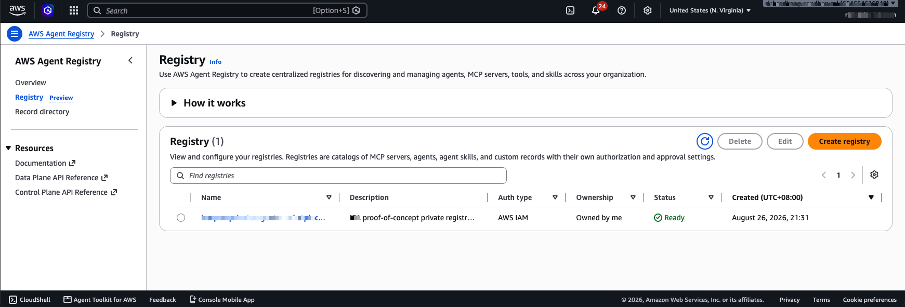

## A hands-on look at the August 6, 2026 GA relaunch, with a real registry, a real evaluation, and the exact SDK/CLI versions you need

AWS Agent Registry quietly went through a breaking migration on **August 6, 2026**: it moved out of the `bedrock-agentcore` namespace it launched preview under (April 9, 2026) and into its own dedicated `agent-registry` / `agent-registry-control` namespace. This isn't a rename — endpoints, IAM action prefixes, ARNs, and API names all changed (`SearchRegistryRecords` became `SearchDiscoverableRegistryRecords`, for one). The old namespace shuts down entirely on **September 17, 2026**, so anything built against the preview API needs to migrate now.

Most of what's written about Agent Registry online — including several good hands-on posts — is preview-era and uses the old API. I built against the new namespace directly, so this post is current as of the GA relaunch.

### What you actually need installed

I hit this myself: the AWS CLI and boto3 versions I had didn't recognize the `agent-registry` service at all. Verified directly against the published package wheels (1.43.65 has neither service model, 1.43.66 has both):

```bash
python -m pip install --upgrade "boto3>=1.43.66,<1.44"
aws --version   # needs AWS CLI v2.36.18 or newer
```

| Component | First supported version | Released |
|---|---|---|
| botocore | 1.43.66 | Aug 6, 2026 |
| boto3 | 1.43.66 | Aug 6, 2026 |
| AWS CLI v2 | 2.36.18 | Aug 6, 2026 |

All three shipped the same day as the namespace GA. If your SDK predates this, the CLI/boto3 simply won't have the `agent-registry`/`agent-registry-control` clients — that's not a permissions problem, it's a version problem.

### What it actually is

A private, governed catalog for agents, MCP servers, tools, skills, and custom resources — with approval workflows (draft → pending → approved/rejected → deprecated), hybrid keyword/semantic search, and an MCP endpoint so agents can discover each other without hardcoding names. Think of it as the piece that sits between "we have a pile of agents scattered across teams" and "there's one place to find and govern them."

Here's the registry I stood up last night, live in my own account:



### Four use cases that actually matter

**1. A governed private agent marketplace.** Records move through a real approval lifecycle — only approved records become discoverable. This is the direct fix for agent sprawl: instead of five teams each quietly building their own "HR lookup agent," there's one place to publish, find, and deprecate them.

**2. Evidence-informed agent selection — this is what I actually built.** Two approved HR-domain records, tagged by capability domain and permitted data sources. On top of native discovery, I layered a reliability service: a genuine AgentCore evaluation result (a real invocation, real judge score) updated a Beta posterior, and discovery results were reranked using the conservative lower bound of that posterior rather than raw search relevance. **Important distinction: this reliability layer is not a native Registry feature.** The Registry gives you the governed catalog and discovery primitives; behavioral reputation scoring is something you build on top.

**3. Natural-language discovery.** The data plane supports hybrid keyword/semantic search, and the registry is also reachable via an MCP endpoint — so an orchestrator can ask for "an agent that can answer restricted HR-record questions" without knowing in advance which team owns it or what it's named.

**4. Quality gates and lifecycle automation.** EventBridge notifications fire on record submission, so you can wire in automated descriptor validation, security review, or evaluation-threshold checks before something becomes discoverable — and deprecate/remove stale versions automatically.

### The one architectural point worth remembering

**Registry is a discovery and governance control plane, not a runtime authorization boundary.** Finding an approved agent through the registry tells you it exists and is approved — it doesn't scope what data or tools that agent can touch for a *specific* requester. That still needs its own policy-resolution and credential-scoping step after selection, not instead of it.

### Sources

- [AWS Agent Registry — public preview announcement](https://aws.amazon.com/blogs/machine-learning/the-future-of-managing-agents-at-scale-aws-agent-registry-now-in-preview/) (April 9, 2026, preview-era API)
- [Comprehensive registry migration guide](https://docs.aws.amazon.com/bedrock-agentcore/latest/devguide/registry-faq.html) — the clearest official record of the August 6 GA namespace change and the September 17 shutdown deadline
- [AWS Agent Registry guide](https://docs.aws.amazon.com/bedrock-agentcore/latest/devguide/registry.html)
- [Agentic Resource Discovery (ARD) — an open specification for agent discovery](https://aws.amazon.com/blogs/machine-learning/agentic-resource-discovery-ard-an-open-specification-for-agent-discovery/) (Aug 24, 2026) — positions Registry as AWS's governed catalog alongside a cross-environment discovery layer
- Community coverage (preview-era API, useful conceptually, don't copy the commands verbatim): [Gerardo Arroyo, "A private catalog to stop agent sprawl"](https://dev.to/aws-builders/aws-agent-registry-a-private-catalog-to-stop-agent-sprawl-c91); [Heeki Park on integrating Registry into an agent platform](https://heeki.medium.com/integrating-aws-agent-registry-into-your-agent-platform-for-discovery-and-governance-3350920204a4); [Bits Lovers, Agent Registry preview](https://www.bitslovers.com/aws-agent-registry-preview/)

I didn't find a standalone indexed "What's New" post for the August namespace GA, and there's no substantial Hacker News or r/aws discussion of it yet — the migration guide is currently the clearest official source. That gap is exactly why a current, hands-on post is worth writing.
