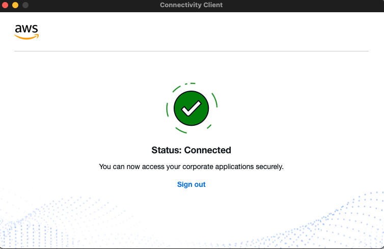
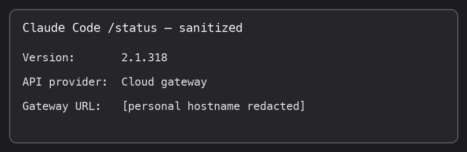
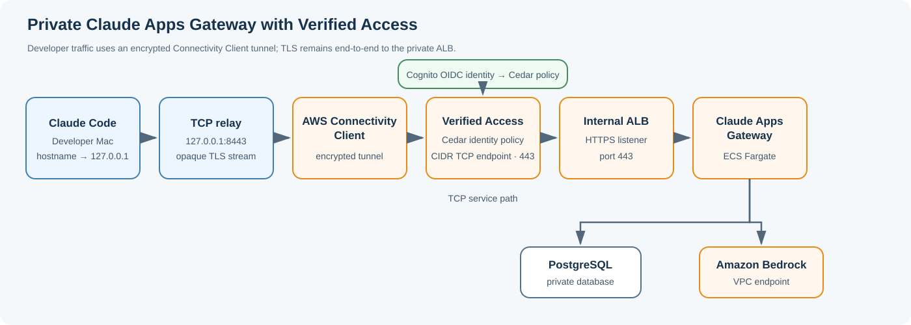
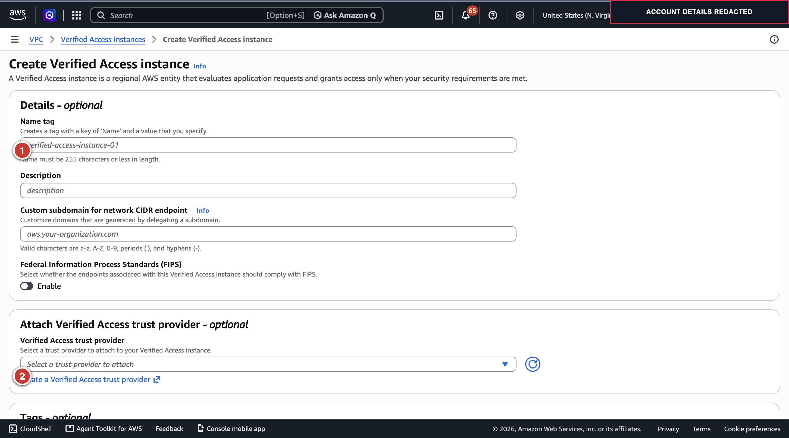
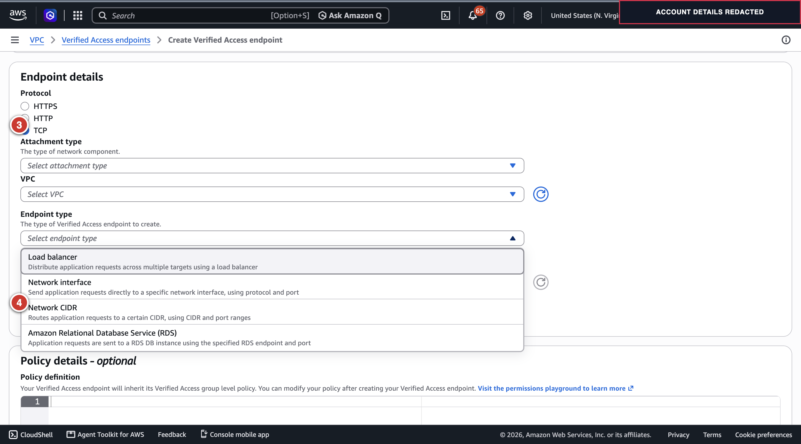

## Overview

Claude Code can use an organization-managed Claude Apps Gateway that routes requests to Amazon Bedrock. Keeping that gateway private is attractive: the gateway can apply identity and model policy, the workload can use an AWS task role for Bedrock, and the ALB does not need to be internet-facing.

The difficulty is the developer’s path to that private gateway. A laptop on the public internet has no route to a VPC address. This proof of concept uses AWS Verified Access plus its Connectivity Client and a local TCP relay to reach the internal gateway.

The working proof of concept used AWS Verified Access’s Connectivity Client and a small local TCP relay. The relay made Claude Code see a loopback address while the encrypted connection traveled through Verified Access to an internal ALB. This avoided a broad, manually managed VPN, but it still required an installed client and local relay.

## Table of contents

- [Overview](#overview)
- [Test results and scope](#test-results-and-scope)
- [Architecture](#architecture)
- [Why use this design](#why-use-this-design)
- [Step-by-step: reproduce the working TCP path](#step-by-step-reproduce-the-working-tcp-path)
  - [1. Prepare the AWS environment](#1-prepare-the-aws-environment)
  - [2. Choose a hostname and issue a certificate](#2-choose-a-hostname-and-issue-a-certificate)
  - [3. Create the temporary Cognito OIDC identity provider](#3-create-the-temporary-cognito-oidc-identity-provider)
  - [4. Deploy Claude Apps Gateway privately](#4-deploy-claude-apps-gateway-privately)
  - [5. Create Verified Access identity resources](#5-create-verified-access-identity-resources)
  - [6. Create the Verified Access CIDR TCP endpoint](#6-create-the-working-verified-access-cidr-tcp-endpoint)
  - [7. Install and connect the Connectivity Client](#7-install-and-connect-the-connectivity-client)
  - [8. Start a loopback TCP relay](#8-start-a-loopback-tcp-relay)
  - [9. Make Claude Code resolve the gateway as loopback](#9-make-claude-code-resolve-the-gateway-as-loopback)
  - [10. Verify TLS and test Claude Code](#10-verify-tls-and-test-claude-code)
  - [11. Clean up](#11-clean-up)
- [Limitations](#limitations)
- [References](#references)

## Test results and scope

> **Test status**
>
> - **Original proof of concept passed:** Claude Code `/login` and a Bedrock inference succeeded through the private gateway using the Connectivity Client and TCP relay. The prompt returned `PONG`; CloudWatch recorded a Bedrock `/v1/messages` request with status `200`.
> - **Fresh retest was inconclusive:** a separate isolated deployment on 2026-11-04 had a healthy internal ALB target, but its Verified Access CIDR endpoint remained `pending` after 12 minutes. AWS did not export a Connectivity Client profile, so no CLI request ran through that deployment. The fresh attempt did not reproduce the earlier success or disprove it.
> - **Clean-room run on 2026-11-05 passed:** the exact-host certificate, Cognito setup, and gateway deployment succeeded. The Verified Access CIDR endpoint remained `pending` during a 12-minute poll while the ALB still had its placeholder ingress rule. After the CDK update replaced that rule with the endpoint security-group source, the endpoint became `active` during the first post-update poll sequence; the endpoint target list matched the ALB's private addresses. The AWS-exported Connectivity Client profile (`ClientConfig-${GATEWAY_NAME}.json`) was installed in the documented config directory during the test, owned by `root:wheel` with mode `600`, and verified byte-for-byte against the export. It was removed during cleanup; the test machine no longer has the profile. The temporary export copy was removed after installation. The first filename omitted AWS's required `ClientConfig-` prefix, which caused the client's “missing or invalid” error; renaming it to the required prefix resolved that issue. The user confirmed the client reported `Connected` and supplied Claude Code `/status` output showing version `2.1.318` and API provider `Cloud gateway`. The test used gateway binary `2.1.299` built from upstream commit `3ea25056f8c9d5ea8e54ba24ad400e831a965e6f`. The visible terminal transcript for `/login` shows `Login successful`; the exact prompt `Reply with exactly PONG.` returned `PONG`. A sanitized CloudWatch query found two upstream Bedrock `/v1/messages` HTTP `200` events; the latest was at `2026-11-05T02:43:56.174Z`.
> - **Clean-room cleanup completed and verified:** the loopback relay was stopped; the hosts file was restored byte-for-byte to its pre-test contents; test managed settings and the test Connectivity Client profile were removed; the Connectivity Client was signed out and its tunnel process exited. The gateway stack, Verified Access resources, VPC, test database, Cognito pool/domain, exact-host certificate, DNS records, ECR repository, and test log group are absent. No test RDS automated backup or manual snapshot remains. AWS retains one `INACTIVE` ECS cluster record with no services or running tasks; it is nonbillable. The client's encrypted secure store and `dbsettings.json` remain in place, and unrelated profiles were left untouched.

> **Repeatability scope:** the steps were followed successfully once in a clean-room run. A second independent reproduction by a different operator or environment has not yet been performed.



*Figure 3. The original Connectivity Client screen shows the Connected state. This verifies tunnel status, not an inference request.*



*Figure 4. Sanitized rendering of the CLI `/status` screen showing version 2.1.318 and the Cloud gateway provider. Session identifiers, peer address, personal hostname, and local paths are omitted. This verifies gateway configuration, not an inference request.*

## Architecture

The diagram below shows the **passing TCP + Connectivity Client setup**. The ALB's HTTPS port 443 is reached through the Verified Access TCP endpoint and local relay.



In the successful test, the developer-facing hostname resolved to `127.0.0.1` because of a temporary `/etc/hosts` entry. A raw TCP relay listened on loopback port `8443` and forwarded the TLS stream to a per-target DNS name returned by a Verified Access CIDR endpoint on port `443`. The relay did not terminate TLS, so Claude Code’s hostname and SNI remained intact.

The Gateway ALB stayed private in VPC `10.20.0.0/16`. Its security group admitted HTTPS only from the Verified Access endpoint security group. ECS tasks used their task role and a Bedrock VPC endpoint to call Bedrock. The AWS Connectivity Client routed the Verified Access service prefix through its encrypted tunnel; the Mac did not receive a direct route to the VPC’s `10.20.x.x` addresses.

## Why use this design

- Keep Claude Apps Gateway behind an internal ALB.
- Use Verified Access identity policy to decide which users can reach the application.
- Keep Bedrock credentials in the ECS task role instead of on developer laptops.
- Route the Verified Access service prefix through the Connectivity Client instead of adding a direct route to the VPC subnets. This PoC did not verify per-application routing.
- Preserve Claude Code’s private-address check by resolving its configured hostname to loopback before the relay forwards traffic.

This is “VPN-less” only in the sense that it avoids a traditional full-device VPN. The Connectivity Client is still installed software that creates an encrypted tunnel.

## Step-by-step: reproduce the working TCP path

### 1. Prepare the AWS environment

Use a dedicated test account or profile and set the target region:

```bash
export AWS_PROFILE=your-test-profile
export AWS_REGION=us-east-1
export RUN_SUFFIX=$(uuidgen | tr -d '-' | cut -c1-8)
export GATEWAY_NAME="claude-gateway-poc-${RUN_SUFFIX}"
aws sts get-caller-identity
printf 'RUN_SUFFIX=%s\nGATEWAY_NAME=%s\n' "$RUN_SUFFIX" "$GATEWAY_NAME"
```

Replace `your-test-profile` with the named profile you configured in AWS CLI; do not paste the placeholder literally.
Confirm the returned account is the intended test account before creating resources.
Run the AWS CLI and CDK command blocks from this same terminal session so `AWS_PROFILE`, `AWS_REGION`, `RUN_SUFFIX`, and `GATEWAY_NAME` stay set. If you open another terminal, export those values again.

The local build path requires AWS CLI v2, Node.js/npm, Docker Desktop with a running Linux container engine and Buildx, GPG, `jq`, `curl`, `shasum`, and `uuidgen`. Check them before deploying:

```bash
aws --version
node --version
npm --version
docker info >/dev/null
docker buildx version
gpg --version
jq --version
shasum -a 256 </dev/null
uuidgen
```

If `docker info` fails, start Docker Desktop and wait for its engine to become ready; do not start the CDK build until this command succeeds.

Before deploying, verify Bedrock access for the model used by the pinned gateway catalog:

```bash
aws bedrock list-inference-profiles \
  --type-equals SYSTEM_DEFINED \
  --query "inferenceProfileSummaries[?inferenceProfileId=='global.anthropic.claude-haiku-4-5-20251001-v1:0'].{Id:inferenceProfileId,Status:status}" \
  --output table
aws bedrock get-foundation-model-availability \
  --model-id anthropic.claude-haiku-4-5-20251001-v1:0 \
  --query 'agreementAvailability.status' \
  --output text
```

The inference profile should be `ACTIVE`, and model availability should be `AVAILABLE`. Complete any Bedrock model-access agreement in the AWS console before continuing if either check fails.

The clean-room test used Claude Code 2.1.318 on the developer Mac and gateway binary 2.1.299 in the container. The gateway was built from sample commit `3ea25056f8c9d5ea8e54ba24ad400e831a965e6f`. These values are distinct: the client version is not the container's version.

The earlier proof of concept did not record the exact Git commit or gateway image version. Its topology, user-side configuration, successful CLI result, and CloudWatch evidence were recorded, but it was not a byte-for-byte deployment lockfile. The 2026-11-05 clean-room run records the pinned sample commit and gateway version above.

Confirm the account can create the VPC, ALB, ECS/Fargate service, RDS PostgreSQL database, VPC endpoints, Cognito resources, ACM certificate, Route 53 records, and Verified Access resources required by the deployment. The test used `AWS_PROFILE=ml-sandbox` and `AWS_REGION=us-east-1`. It created temporary AWS resources and removed them after the smoke test.

Choose one hostname, for example `gateway.example.com`, and substitute it consistently in the certificate, gateway configuration, Cognito callback, managed Claude Code settings, hosts entry, and TLS verification. The test used a Route 53 hosted zone in the same AWS account as the `ml-sandbox` profile. The CDK stack writes the gateway record into that zone. A zone in another AWS account requires cross-account DNS deployment steps outside this guide; when using a public hosted zone, pass its hosted-zone ID explicitly.

Keep the gateway ALB and Verified Access endpoint in the **same VPC**. The sample CDK stack creates a VPC by default; deploy it first, then create the Verified Access endpoint attached to that VPC. If you create the VPC yourself, pass that same VPC ID into the CDK deployment using the sample's `vpcId` option, and verify the selected private subnets and required VPC endpoints before proceeding. Do not create a separate probe VPC for the Verified Access endpoint.

The successful test used a VPC with these CIDRs:

| Component | Tested example |
|---|---|
| VPC | `10.20.0.0/16` |
| Private subnet A | `10.20.1.0/24` |
| Private subnet B | `10.20.2.0/24` |
| Verified Access CIDR endpoint | `10.20.0.0/22`, TCP `443` |

Treat these as values from that test, not guaranteed defaults. When reproducing, use the actual VPC ID, CIDR, and private subnet IDs created by the CDK stack (or the VPC you explicitly pass with `vpcId`). The Verified Access endpoint must attach to that same VPC, and its endpoint CIDR must be within that VPC and cover the private ALB subnets. Do not copy `10.20.0.0/22` unless it fits the VPC you deployed.

The official gateway stack needs external egress for some identity-provider traffic and AWS service connectivity. The test used a NAT gateway and VPC endpoints for Bedrock Runtime, ECR, Secrets Manager, CloudWatch Logs, CloudWatch Monitoring, and S3.

### 2. Choose a hostname and issue a certificate

Choose a test hostname in a Route 53 hosted zone, for example:

```text
gateway.example.com
```

Request a public ACM certificate in `us-east-1`, create its DNS validation CNAME, and wait for `ISSUED`. The internal ALB can use a public certificate without becoming internet-facing.

Keep the complete hostname at or below ACM's 64-character domain-name limit. ACM rejects a longer name at certificate request time. In a long hosted zone, choose a short record label such as `gw-1105` rather than a long descriptive prefix.

Set the values you will reuse in later commands:

```bash
export GATEWAY_HOST='gw-1105.example.com'
export DNS_ZONE='example.com'
export HOSTED_ZONE_ID='<route53-hosted-zone-id>'
export CERT_ARN='<issued-acm-certificate-arn>'
```

Choose a unique short host label for each run, keeping the full domain at or below 64 characters.

For this TCP/relay setup, the public application A/AAAA record is not the relay destination. The local hosts entry makes Claude Code connect to loopback, and the relay connects to the separate Verified Access target DNS name. The CDK record points to the internal ALB; in the test, the public hosted zone returned the ALB's private addresses, which did not make the ALB internet-reachable. The ALB security group remains the access boundary.

Register the Claude Apps Gateway Cognito client callback as:

```text
https://gateway.example.com:8443/oauth/callback
```

Register the Verified Access Connectivity Client OIDC callback as:

```text
http://localhost:8000
```

Use separate OIDC app clients for Verified Access and Claude Apps Gateway. For Cognito, allow the `openid`, `email`, and `profile` scopes. Cognito rejects `offline_access`.

### 3. Create the temporary Cognito OIDC identity provider

The test used a temporary Cognito User Pool with one verified email identity. In **Amazon Cognito → User pools**:

1. Create a pool named `${GATEWAY_NAME}-userpool`. Enable email sign-in, self-service sign-up, and email verification.
2. Create a unique hosted UI/domain prefix such as `cgrgw-${RUN_SUFFIX}`.
3. Create one app client named `${GATEWAY_NAME}-va` for the AWS Connectivity Client / Verified Access sign-in. Configure its OAuth authorization-code flow, required scopes, and callback `http://localhost:8000`.
4. Create a different app client named `${GATEWAY_NAME}-gateway` for Claude Apps Gateway, using authorization-code flow and callback `https://gateway.example.com:8443/oauth/callback`.
5. In **App integration → App clients**, open the Verified Access client’s **View login page**. Choose **Sign up**, enter the test email, set a temporary password, and enter the verification code sent to that mailbox. The sign-up URL follows this pattern:

   ```text
   https://<domain-prefix>.auth.<region>.amazoncognito.com/signup?response_type=code&client_id=<verified-access-client-id>&redirect_uri=http%3A%2F%2Flocalhost%3A8000&scope=openid%20email%20profile
   ```

   Keep the password and one-time code in the browser only. Do not put them in terminal history, files, or screenshots.
   After confirmation, Cognito may redirect to `http://localhost:8000` before the Connectivity Client is running. If the browser reports that localhost is unavailable, verify the user is `CONFIRMED` in the Cognito pool; complete the client sign-in later after launching Connectivity Client.
6. Record the issuer URL, client IDs, and secrets in a secure local secret store. Do not put secrets into the blog, CDK source, screenshots, or shell history.

Before creating the Verified Access Cedar policy, verify the user's exact email and confirmation state:

```bash
aws cognito-idp list-users --user-pool-id "$USER_POOL_ID" \
  --query 'Users[].{Email:Attributes[?Name==`email`].Value|[0],Status:UserStatus,EmailVerified:Attributes[?Name==`email_verified`].Value|[0]}' \
  --output table
```

Use that exact `Email` value in the Cedar policy and make sure `ALLOWED_EMAIL_DOMAINS` matches its domain. Stop if they differ; do not broaden the policy to work around a mismatch.

Set the non-secret values used by the later AWS CLI and image-stamping commands:

```bash
export USER_POOL_ID='<cognito-user-pool-id>'
export COGNITO_DOMAIN_PREFIX='<cognito-hosted-domain-prefix>'
export VA_OIDC_CLIENT_ID='<verified-access-app-client-id>'
export GATEWAY_OIDC_CLIENT_ID='<gateway-app-client-id>'
export OIDC_ISSUER="https://cognito-idp.us-east-1.amazonaws.com/$USER_POOL_ID"
export ALLOWED_EMAIL_DOMAINS='<domain-of-your-verified-test-email>'
```

Keep the two app-client secrets in a secure secret store. The gateway client secret is entered through the hidden prompt in the Secrets Manager step; the Verified Access client secret is entered in the trust-provider form.

The Verified Access trust provider and Claude Apps Gateway are distinct OIDC clients even though they use the same temporary User Pool. Their callbacks and sign-in sessions are separate.

### 4. Deploy Claude Apps Gateway privately

Deploy the official sample with:

- An internal IPv4 ALB listening on HTTPS port `443`.
- ECS Fargate tasks for Claude Apps Gateway.
- PostgreSQL for gateway state.
- An ECR repository and the sample’s pinned Claude Code binary/image.
- An ECS task role with the sample’s required Bedrock invoke permissions.
- VPC endpoints and NAT egress as required by the sample.

Use the pinned reference revision and the CDK sequence below to deploy in the test account and region. Set the gateway's `public_url` to:

```text
https://gateway.example.com:8443
```

Here, `8443` is the developer’s local relay port. The Verified Access endpoint and internal ALB use port `443`.

Provide the gateway’s OIDC issuer and client ID in the gateway config. Store the OIDC client secret in Secrets Manager and inject it into the ECS service; do not bake it into the image or commit it to a file.

In `cdk/gateway.yaml.template`, under `oidc:`, add this active setting (the template's default includes `offline_access`, which Cognito rejects):

```yaml
  scopes: [openid, email, profile]
```

Confirm the generated `gateway.yaml` contains this Cognito-compatible setting before building the image.

The sample deployment guide uses two CDK passes: first create ECR, then stage the pinned Linux Claude Code binary and gateway configuration, build and push the image, and deploy the full ECS/ALB/RDS stack. After the full stack is created, write the real OIDC secret to Secrets Manager and restart the ECS service so the tasks load it. Get the exact sample revision used by this procedure:

```bash
git clone https://github.com/aws-samples/anthropic-on-aws.git
cd anthropic-on-aws
git checkout 3ea25056f8c9d5ea8e54ba24ad400e831a965e6f
cd claude-apps-gateway/cdk
```

See the sample's [canonical deployment guide](https://github.com/aws-samples/anthropic-on-aws/blob/3ea25056f8c9d5ea8e54ba24ad400e831a965e6f/claude-apps-gateway/docs/deployment.md) and [CDK guide](https://github.com/aws-samples/anthropic-on-aws/blob/3ea25056f8c9d5ea8e54ba24ad400e831a965e6f/claude-apps-gateway/cdk/README.md).

The sample hardcodes the CloudFormation stack name `ClaudeGatewayStack`. Before deploying, confirm that stack name is unused in the selected account and region; only one deployment of this CDK sample can use it there at a time. `GATEWAY_NAME` controls the ECR repository, ECS cluster/service, secrets, and log group, so use a unique value for each isolated run.

**Apply this CDK compatibility change before pass 2.** The reference revision strips the URL scheme but leaves `:8443` in the Route 53 record name. In `cdk/lib/claude-gateway-stack.ts`, change the record hostname parsing to:

```ts
const recordHost = new URL(publicUrl).hostname;
```

This keeps the Route 53 record name to `gateway.example.com`; retain `:8443` in `publicUrl` and the OAuth callback. Without this change, the pass-2 CDK deployment can fail while creating the DNS record. This is a correction for the pinned reference revision, not a claim about the original test commit.

At the pinned reference revision listed above, the CDK sequence is:

1. In `claude-apps-gateway/cdk`, install dependencies and bootstrap the account/region: `npm install` and `npx cdk bootstrap -c imageReady=false`.
2. Deploy pass 1 with `npx cdk deploy -c imageReady=false -c gatewayName="$GATEWAY_NAME"`; this creates the ECR repository. Record the `EcrRepositoryUri` output.
3. Stamp `gateway.yaml` with the gateway hostname, Cognito issuer/client ID, and the domain of the verified test email:

   ```bash
   PUBLIC_URL="https://${GATEWAY_HOST}:8443" \
   AWS_REGION=us-east-1 \
   OIDC_ISSUER="$OIDC_ISSUER" \
   OIDC_CLIENT_ID="$GATEWAY_OIDC_CLIENT_ID" \
   ALLOWED_EMAIL_DOMAINS="$ALLOWED_EMAIL_DOMAINS" \
     ./scripts/stamp-config.sh
   grep -nE '^[[:space:]]*scopes:' gateway.yaml
   ```

The active `oidc.scopes` line should be `scopes: [openid, email, profile]`. The pinned template contains comment-only examples mentioning `offline_access`; those comments are not active configuration.

4. Stage and verify the pinned Linux x64 Claude Code binary, then build and push the image. This Bash snippet follows the pinned sample's GPG-signed release-manifest procedure. The `VERSION` is the gateway image binary version, not the developer CLI version:

   ```bash
   # Run in Bash from the sample's cdk/ directory.
   (
     set -euo pipefail
     GNUPGHOME=$(mktemp -d)
     TMP_RELEASE_DIR=$(mktemp -d)
     cleanup_build_temps() {
       gpgconf --homedir "$GNUPGHOME" --kill all >/dev/null 2>&1 || true
       find "$TMP_RELEASE_DIR" -depth -mindepth 1 -delete
       rmdir "$TMP_RELEASE_DIR"
       find "$GNUPGHOME" -depth -mindepth 1 -delete
       rmdir "$GNUPGHOME"
     }
     trap cleanup_build_temps EXIT
     export GNUPGHOME

     VERSION=$(sed -n 's/^CLAUDE_VERSION="${CLAUDE_VERSION:-\(.*\)}"$/\1/p' scripts/setup.sh)
     RELEASES_URL=https://downloads.claude.ai/claude-code-releases
     KEYS_URL=https://downloads.claude.ai/keys/claude-code.asc
     GPG_FINGERPRINT=31DDDE24DDFAB679F42D7BD2BAA929FF1A7ECACE

     curl -fsSL "$KEYS_URL" | gpg --import
     gpg --fingerprint security@anthropic.com | tr -d ' ' | grep -qi "$GPG_FINGERPRINT"
     curl -fsSL -o "$TMP_RELEASE_DIR/manifest.json" \
       "$RELEASES_URL/$VERSION/manifest.json"
     curl -fsSL -o "$TMP_RELEASE_DIR/manifest.json.sig" \
       "$RELEASES_URL/$VERSION/manifest.json.sig"
     gpg --verify "$TMP_RELEASE_DIR/manifest.json.sig" "$TMP_RELEASE_DIR/manifest.json"
     EXPECTED_SHA=$(jq -r '.platforms["linux-x64"].checksum' "$TMP_RELEASE_DIR/manifest.json")
     curl -fL -o claude \
       "$RELEASES_URL/$VERSION/linux-x64/claude"
     chmod +x claude
     printf '%s  claude\n' "$EXPECTED_SHA" | shasum -a 256 -c

     ECR_URI=$(aws cloudformation describe-stacks \
       --stack-name ClaudeGatewayStack \
       --query "Stacks[0].Outputs[?OutputKey=='EcrRepositoryUri'].OutputValue" \
       --output text)
     aws ecr get-login-password --region us-east-1 |
       docker login --username AWS --password-stdin "${ECR_URI%%/*}"
     docker build --platform=linux/amd64 --provenance=false \
       -t "${ECR_URI}:${VERSION}" .
     docker push "${ECR_URI}:${VERSION}"
   )
   ```

The subshell uses a temporary GPG home so the signing key does not remain in the user's default keyring.
5. Deploy pass 2 with:

   ```bash
   npx cdk deploy \
     -c gatewayName="$GATEWAY_NAME" \
     -c publicUrl="https://${GATEWAY_HOST}:8443" \
     -c zoneName="$DNS_ZONE" \
     -c zoneId="$HOSTED_ZONE_ID" \
     -c certArn="$CERT_ARN" \
     -c ingressCidr=192.0.2.1/32 \
     -c imageTag=2.1.299
   ```

   Use the same `publicUrl` and identity settings used to stamp the image. `192.0.2.1/32` is a documentation-only address used to satisfy the sample's required CIDR parameter without admitting a real client. Replace the ALB security-group rule with the Verified Access endpoint security-group rule immediately after creating the endpoint and before testing connectivity.
6. Store the gateway OIDC app-client secret at `${GATEWAY_NAME}-oidc-client-secret` in Secrets Manager and force a new ECS deployment. With the example name, the ECS cluster and service are both `claude-gateway-poc-20261105`:

   Run this block in Bash. It reads the secret without echoing it and streams it to the AWS CLI through standard input; it does not write the secret to a local file or command history. On macOS, enter `bash` first if your login shell is zsh.

   ```bash
   (
     set -euo pipefail
     set +x
     read -r -s -p 'OIDC client secret: ' OIDC_CLIENT_SECRET
     printf '\n'
     printf '%s' "$OIDC_CLIENT_SECRET" |
       aws secretsmanager put-secret-value \
         --secret-id "${GATEWAY_NAME}-oidc-client-secret" \
         --secret-string file:///dev/stdin
     unset OIDC_CLIENT_SECRET
   )
   aws ecs update-service \
     --cluster "$GATEWAY_NAME" \
     --service "$GATEWAY_NAME" \
     --force-new-deployment
   ```

   Verify the ECS service reaches steady state before testing:

   ```bash
   aws ecs wait services-stable \
     --cluster "$GATEWAY_NAME" \
     --services "$GATEWAY_NAME"
   ```

The original PoC's exact CDK commit and build log were not retained, so these steps describe the pinned reference revision above rather than claiming it is the identical build used for the successful inference. The tested ALB ingress also used the Verified Access endpoint security group; replace the sample's placeholder `ingressCidr` rule before treating the network path as restricted.

For this PoC, the developer-facing `public_url` included `:8443`; the local relay listened on that port, while the ALB itself terminated TLS on `443`. After the Verified Access endpoint exists, tighten the ALB security group so inbound HTTPS is allowed only from the Verified Access endpoint security group. Do not leave the sample's broader placeholder/client CIDR rule in place. The successful test relied on the endpoint security-group reference as its network boundary.

The successful run emitted warnings that `access_control.allow_cidrs` was empty and `listen.trusted_proxies` was unset. The ALB security group still restricted network ingress to the Verified Access endpoint. The test did not record the source addresses needed to choose gateway-level CIDRs or trusted-proxy values. Before production, measure the source addresses observed at the gateway, set the allow-list and trusted proxy configuration from that evidence, and repeat `/login` and inference tests.

### 5. Create Verified Access identity resources

In the AWS Console, select **US East (N. Virginia) / `us-east-1`**, then open **VPC → AWS Verified Access**. Create the identity objects in this order:



*Figure 1. Create Verified Access instance: ① instance name; ② create or attach the OIDC trust provider. The account profile area is masked.*

1. Choose **Verified Access instances → Create Verified Access instance**. Add a clear name and description. Attach the OIDC trust provider after creating it.
2. Choose **Verified Access trust providers → Create Verified Access trust provider**. Select **User trust provider / OIDC**, provide the Cognito issuer and app-client details for the Connectivity Client, and use the required localhost callback. Add the provider to the instance.
3. Create a Verified Access group attached to that instance and trust provider. Give it a restrictive Cedar policy for the test user. The test used an email-only policy similar to:

```cedar
permit(principal, action, resource)
when {
  context.claude_va_loopback_idp.email == "developer@example.com"
};
```

The policy-reference alias in the expression must match the trust provider’s configured alias. Use a dedicated test user and remove the temporary pool after the test.

Use `$GATEWAY_NAME` in the instance/group/trust-provider names or descriptions so the PoC resources are easy to identify during cleanup.

After the instance is created, copy its ID from the instance details and set it in the terminal where you run the AWS CLI commands:

```bash
export VA_INSTANCE_ID='vai-<verified-access-instance-id>'
export VA_TRUST_PROVIDER_ID='vatp-<verified-access-trust-provider-id>'
export VA_GROUP_ID='vag-<verified-access-group-id>'
```

For the user trust provider, set the issuer to the Cognito issuer value shown inside the discovery document (for a User Pool, it has the form `https://cognito-idp.<region>.amazonaws.com/<user-pool-id>`). Do not enter the discovery document URL ending in `/.well-known/openid-configuration` as the issuer. Verify that the authorization, token, and user-info endpoints match Cognito's discovery document. Configure only the claims/scopes needed by the policy, including `email`. Do not capture the app-client secret in a screenshot.

Fetch the discovery values from the pool and use them in both OIDC option sections:

```bash
OIDC_DISCOVERY_URL="https://cognito-idp.us-east-1.amazonaws.com/${USER_POOL_ID}/.well-known/openid-configuration"
curl -fsSL "$OIDC_DISCOVERY_URL" |
  jq '{issuer,authorization_endpoint,token_endpoint,userinfo_endpoint,jwks_uri}'
```

For a TCP endpoint, also complete the trust provider's **Native application OIDC options**. These are separate fields from the regular OIDC options; copy the same Cognito issuer, authorization endpoint, token endpoint, user-info endpoint, Verified Access app-client ID, app-client secret, and space-delimited scopes (`openid email profile`) into the native section. Set **Public signing key URL** to Cognito's `jwks_uri` from the discovery document. For a pool in `us-east-1`, the URL has this form:

```text
https://cognito-idp.us-east-1.amazonaws.com/<user-pool-id>/.well-known/jwks.json
```

The AWS API/CLI property is `NativeApplicationOidcOptions` / `--native-application-oidc-options`. Keep the native and regular OIDC values aligned with the same Verified Access app client. The client secret is sensitive: enter it in the AWS console field and do not paste it into a terminal command or this blog. Verified Access rejects TCP endpoint creation if the native options are missing.

### 6. Create the working Verified Access CIDR TCP endpoint

The first TCP load-balancer endpoint stayed `pending` for more than 12 minutes. The working test used a Verified Access **CIDR endpoint** instead:

- VPC attachment.
- The two private subnets.
- CIDR `10.20.0.0/22`.
- Protocol `tcp`.
- Port range `443`–`443`.
- A dedicated endpoint security group.

Read the VPC and ALB details from the deployed CloudFormation stack before creating the endpoint:

```bash
VPC_ID=$(aws cloudformation list-stack-resources \
  --stack-name ClaudeGatewayStack \
  --query 'StackResourceSummaries[?ResourceType==`AWS::EC2::VPC`].PhysicalResourceId | [0]' \
  --output text)
VPC_CIDR=$(aws ec2 describe-vpcs --vpc-ids "$VPC_ID" \
  --query 'Vpcs[0].CidrBlock' --output text)
ALB_DNS=$(aws cloudformation describe-stacks \
  --stack-name ClaudeGatewayStack \
  --query "Stacks[0].Outputs[?OutputKey=='AlbDnsName'].OutputValue | [0]" \
  --output text)
printf 'VPC_ID=%s\nVPC_CIDR=%s\nALB_DNS=%s\n' "$VPC_ID" "$VPC_CIDR" "$ALB_DNS"

aws ec2 describe-subnets \
  --filters "Name=vpc-id,Values=$VPC_ID" \
  --query 'Subnets[].{SubnetId:SubnetId,CIDR:CidrBlock,AZ:AvailabilityZone,Tags:Tags}' \
  --output table
dig +short "$ALB_DNS"
aws elbv2 describe-load-balancers \
  --query "LoadBalancers[?DNSName=='$ALB_DNS'].{Name:LoadBalancerName,VpcId:VpcId,SecurityGroups:SecurityGroups}" \
  --output table
```

In the subnet table, choose the two private subnets in different Availability Zones. Use a CIDR that contains the ALB's private IPs and fits the VPC; `10.20.0.0/22` was the tested value for the VPC shown above, not a universal default. The load-balancer query gives the ALB security group to edit after endpoint creation.

Copy that security group ID into the same terminal for the cleanup step:

```bash
export ALB_SG_ID='<alb-security-group-id-from-the-load-balancer-query>'
```

In the console, choose **Verified Access endpoints → Create Verified Access endpoint**, select the **CIDR** endpoint type, attach it to the same VPC as the internal ALB, select its private subnets, enter a CIDR within that VPC that covers the ALB (`10.20.0.0/22` in the test, only if it fits your VPC), choose TCP port 443, and select the dedicated endpoint security group. The group Cedar policy must allow the test identity to perform the endpoint action.

Use `$GATEWAY_NAME` in the endpoint description or tags to identify it during cleanup.

After creation, copy its endpoint ID and dedicated security-group ID from the endpoint details:

```bash
export VA_CIDR_ENDPOINT_ID='vae-<verified-access-endpoint-id>'
export VA_ENDPOINT_SG_ID='sg-<verified-access-endpoint-security-group-id>'
```



*Figure 2. Create the passing endpoint: ③ select TCP; ④ select Network CIDR. The account profile area is masked.*

Before polling for endpoint activation or testing connectivity, update the CDK code below so the Verified Access endpoint security group replaces the placeholder as a CloudFormation-managed ALB rule. The first full stack deploy allows only the documentation-only `192.0.2.1/32` source; editing the rule only in the console would create drift and could collide with the CDK update.

1. In `cdk/lib/claude-gateway-stack.ts`, add this optional property to `GatewayStackProps`:

   ```ts
   readonly verifiedAccessEndpointSecurityGroupId?: string;
   ```

2. In `cdk/bin/app.ts`, pass the context value into the stack:

   ```ts
   verifiedAccessEndpointSecurityGroupId: ctx('verifiedAccessEndpointSecurityGroupId'),
   ```

3. In the pass-2 required-input section of `cdk/lib/claude-gateway-stack.ts`, replace the original `const ingressCidr = req(props.ingressCidr, 'ingressCidr');` with:

   ```ts
   const ingressCidr = props.ingressCidr;
   const verifiedAccessEndpointSecurityGroupId = props.verifiedAccessEndpointSecurityGroupId;
   if (Boolean(ingressCidr) === Boolean(verifiedAccessEndpointSecurityGroupId)) {
     throw new Error('Set exactly one of ingressCidr or verifiedAccessEndpointSecurityGroupId');
   }
   ```

4. Replace the original ALB `allowFrom(ec2.Peer.ipv4(ingressCidr), ...)` block with:

```ts
if (verifiedAccessEndpointSecurityGroupId) {
  const vaEndpointSg = ec2.SecurityGroup.fromSecurityGroupId(
    this,
    'VerifiedAccessEndpointSg',
    verifiedAccessEndpointSecurityGroupId,
  );
  fargate.loadBalancer.connections.allowFrom(
    vaEndpointSg,
    ec2.Port.tcp(443),
    'Verified Access endpoint to gateway ALB',
  );
} else {
  fargate.loadBalancer.connections.allowFrom(
    ec2.Peer.ipv4(ingressCidr!),
    ec2.Port.tcp(443),
    'developers to ALB (HTTPS)',
  );
}
```

The validation requires exactly one ingress source. Pass `ingressCidr=192.0.2.1/32` on the first full deployment so no real client can reach the ALB. After creating the Verified Access endpoint and its security group, deploy the stack again with that security-group ID; the CIDR rule is then removed and replaced by the endpoint security-group reference. Confirm the ALB security group has exactly the Verified Access endpoint security group as its HTTPS source before polling for endpoint activation or testing. This CDK hardening was not part of the historical successful run, so the clean-room CLI test must verify the patched deployment too.

For that final CDK update, use the same context values as pass 2, but replace `-c ingressCidr=...` with the Verified Access endpoint security-group ID. Use the `VA_ENDPOINT_SG_ID` value you exported after creating the endpoint; if you opened a new terminal, export that same ID again. Run the command from the sample's `cdk/` directory:

```bash
npx cdk deploy \
  -c gatewayName="$GATEWAY_NAME" \
  -c publicUrl="https://${GATEWAY_HOST}:8443" \
  -c zoneName="$DNS_ZONE" \
  -c zoneId="$HOSTED_ZONE_ID" \
  -c certArn="$CERT_ARN" \
  -c verifiedAccessEndpointSecurityGroupId="$VA_ENDPOINT_SG_ID" \
  -c imageTag=2.1.299
```

Run this after updating the stack code. Keep the hostname, hosted-zone ID, certificate ARN, and image tag identical to pass 2. This update makes the Verified Access security-group rule part of CloudFormation so later deployments do not restore the placeholder CIDR rule. Wait for CloudFormation to report `UPDATE_COMPLETE`, then verify that the ALB HTTPS ingress source is exactly the endpoint security group.

The clean-room run on 2026-11-05 showed why this update must precede the endpoint status poll: the CIDR endpoint stayed `pending` during a 12-minute poll before the ALB rule update. After the CDK update completed, an immediate check still showed `pending`, but the endpoint became `active` by the fourth 15-second poll. Its returned target IPs matched the ALB's private addresses. Poll only after the ALB rule update:

```bash
for ((attempt=1; attempt<=48; attempt++)); do
  VA_STATUS=$(aws ec2 describe-verified-access-endpoints \
    --verified-access-endpoint-ids "$VA_CIDR_ENDPOINT_ID" \
    --query 'VerifiedAccessEndpoints[0].Status.Code' \
    --output text) || {
      echo "Endpoint status query failed; stop and inspect the endpoint." >&2
      exit 1
    }
  printf 'Verified Access endpoint status: %s (%s/48)\n' "$VA_STATUS" "$attempt"
  if [ "$VA_STATUS" = active ]; then break; fi
  if [ "$VA_STATUS" != pending ]; then
    echo "Endpoint entered a non-pending state; inspect it before continuing." >&2
    exit 1
  fi
  sleep 15
done
if [ "$VA_STATUS" != active ]; then
  echo "Endpoint did not become active within 12 minutes; stop here and inspect its status." >&2
  exit 1
fi
```

Retrieve the per-target IP and DNS names:

```bash
aws ec2 get-verified-access-endpoint-targets \
  --verified-access-endpoint-id "$VA_CIDR_ENDPOINT_ID" \
  --query 'VerifiedAccessEndpointTargets[].{IP:VerifiedAccessEndpointTargetIpAddress,DNS:VerifiedAccessEndpointTargetDns}' \
  --output table
```

Choose a row whose IP matches one of the ALB private addresses returned by `dig +short "$ALB_DNS"`, then set that row's DNS name for the relay:

```bash
export VA_TARGET_HOST='<target-dns-name-from-Verified-Access>'
```

Use this target DNS name as the relay upstream. It represents a private target address through the Verified Access endpoint; connecting directly to the `10.20.x.x` address from the Mac did not route through the client.

Do not test connectivity until the endpoint is active, the target IP matches an ALB private address, and the CloudFormation-managed ALB HTTPS rule references only the endpoint security group.

### 7. Install and connect the Connectivity Client

The Connectivity Client requires IPv6 to be enabled on the Mac and an IPv6-capable path to the Verified Access service. Disconnect other VPN clients before testing so they do not override the client routes.

The successful run used Connectivity Client 1.1.1 on macOS (build `20261022.185454`). Check the installed version before downloading or installing anything:

```bash
CLIENT_APP="/Applications/Connectivity Client/Connectivity Client.app"
if [ -d "$CLIENT_APP" ]; then
  CLIENT_VERSION=$(defaults read "$CLIENT_APP/Contents/Info" CFBundleShortVersionString)
  CLIENT_BUILD=$(defaults read "$CLIENT_APP/Contents/Info" CFBundleVersion)
  printf 'Connectivity Client version: %s (build %s)\n' "$CLIENT_VERSION" "$CLIENT_BUILD"
else
  CLIENT_VERSION=not-installed
  echo "Connectivity Client is not installed"
fi
```

If version `1.1.1` is already installed, reuse it and skip installation. If another version is installed, follow AWS's documented uninstall process before installing a different version. Only when the app is absent, download the signed AWS Connectivity Client package through AWS's [Connectivity Client documentation](https://docs.aws.amazon.com/verified-access/latest/ug/connectivity-client.html), check it, and install it:

```bash
pkgutil --check-signature AWSConnectivityClient.pkg
spctl --assess --type install --verbose=2 AWSConnectivityClient.pkg
sudo installer -pkg AWSConnectivityClient.pkg -target /
```

Export the Verified Access instance configuration to a unique temporary file. It includes the Verified Access OIDC client secret. The source file is protected by `umask 077` and removed automatically after installation. AWS requires the installed JSON filename to start with `ClientConfig-`; the app will ignore filenames without that prefix.

```bash
CLIENT_CONFIG_DIR="/Library/Application Support/Connectivity Client"
CLIENT_PROFILE_PATH="$CLIENT_CONFIG_DIR/ClientConfig-${GATEWAY_NAME}.json"
CLIENT_PROFILE_MARKER="$HOME/.${GATEWAY_NAME}-client-profile-installed"
export CLIENT_PROFILE_PATH CLIENT_PROFILE_MARKER
if ! sudo test -d "$CLIENT_CONFIG_DIR"; then
  sudo install -d -o root -g wheel -m 755 "$CLIENT_CONFIG_DIR"
fi
(
  set -euo pipefail
  umask 077
  CLIENT_CONFIG_PATH=$(mktemp "$HOME/${GATEWAY_NAME}-ClientConfig.XXXXXX")
  trap 'rm -f "$CLIENT_CONFIG_PATH"' EXIT
  if sudo test -e "$CLIENT_PROFILE_PATH" || [ -e "$CLIENT_PROFILE_MARKER" ]; then
    echo "A profile or run marker with this test name already exists; stop and choose a new GATEWAY_NAME." >&2
    exit 1
  fi
  aws ec2 export-verified-access-instance-client-configuration \
    --verified-access-instance-id "$VA_INSTANCE_ID" \
    --output json \
    > "$CLIENT_CONFIG_PATH"
  test -s "$CLIENT_CONFIG_PATH"
  if ! sudo install -o root -g wheel -m 600 \
    "$CLIENT_CONFIG_PATH" \
    "$CLIENT_PROFILE_PATH"; then
    sudo rm -f "$CLIENT_PROFILE_PATH"
    exit 1
  fi
  if ! touch "$CLIENT_PROFILE_MARKER"; then
    sudo rm -f "$CLIENT_PROFILE_PATH"
    exit 1
  fi
)
```

Open the app installed by the AWS package, select the new test configuration if prompted, and authenticate with the temporary Cognito test user:

```bash
open "/Applications/Connectivity Client/Connectivity Client.app"
```

Keep passwords and verification codes in the browser/system dialog; do not put them in terminal history, screenshots, or this blog.

After sign-in, confirm the client reports Connected. The exported file is sensitive client configuration. Never attach it to a ticket or commit it.

The Connectivity Client stores its access and refresh tokens in its encrypted local secure store. Sign out at cleanup to disconnect the tunnel; leave the existing secure-store database and unrelated profiles in place.

### 8. Start a loopback TCP relay

The relay listens only on `127.0.0.1:8443`, opens a TCP connection to the Verified Access target DNS name on port `443`, and pipes bytes in both directions. It must not terminate TLS.

Create `relay.mjs`:

```bash
cat > relay.mjs <<'EOF'
import net from "node:net";

const targetHost = process.env.VA_TARGET_HOST;
const listenHost = "127.0.0.1";
const listenPort = 8443;

if (!targetHost) throw new Error("Set VA_TARGET_HOST to a Verified Access target DNS name");

net.createServer((client) => {
  const upstream = net.connect(443, targetHost);
  client.pipe(upstream);
  upstream.pipe(client);
  client.on("error", () => upstream.destroy());
  upstream.on("error", () => client.destroy());
}).listen(listenPort, listenHost, () => {
  console.log(`TCP relay listening on ${listenHost}:${listenPort}`);
});
EOF
```

Run it with the active per-target DNS name:

```bash
node relay.mjs
```

### 9. Make Claude Code resolve the gateway as loopback

Add the temporary `/etc/hosts` entry:

```text
127.0.0.1 gateway.example.com
```

On macOS, check first and append it only if it is not already present:

```bash
HOSTS_MARKER="$HOME/.${GATEWAY_NAME}-hosts-entry-added"
if [ -e "$HOSTS_MARKER" ]; then
  echo "A stale hosts marker exists; stop and resolve it before this run." >&2
elif ! grep -qE '^127\.0\.0\.1[[:space:]]+gateway\.example\.com([[:space:]]|$)' /etc/hosts; then
  printf '127.0.0.1 gateway.example.com\n' | sudo tee -a /etc/hosts >/dev/null \
    && touch "$HOSTS_MARKER"
else
  echo 'The mapping already exists; this run will not remove it during cleanup.'
fi
```

Flush and verify the resolver:

```bash
sudo dscacheutil -flushcache
dscacheutil -q host -a name gateway.example.com
```

Install a temporary managed setting at:

```text
/Library/Application Support/ClaudeCode/managed-settings.json
```

This procedure expects a dedicated test macOS account with no existing managed settings file. Check both the file and the run marker; if either exists, stop and use a clean test account rather than overwriting an organization-managed policy:

```bash
SETTINGS_PATH="/Library/Application Support/ClaudeCode/managed-settings.json"
SETTINGS_MARKER="$HOME/.${GATEWAY_NAME}-managed-settings.sha256"
if [ -e "$SETTINGS_MARKER" ] || [ -e "$SETTINGS_PATH" ]; then
  echo 'Existing managed settings found; stop and use a clean test macOS account.' >&2
else
  echo 'No existing managed-settings file; safe to create the PoC file.'
fi
```

Create the directory and settings file from Terminal:

```bash
sudo install -d -o root -g wheel -m 755 \
  "/Library/Application Support/ClaudeCode"
SETTINGS_PATH="/Library/Application Support/ClaudeCode/managed-settings.json"
SETTINGS_MARKER="$HOME/.${GATEWAY_NAME}-managed-settings.sha256"
if sudo test -e "$SETTINGS_PATH" || [ -e "$SETTINGS_MARKER" ]; then
  echo 'Existing managed settings found; stop without changing it.' >&2
else
  sudo tee "$SETTINGS_PATH" >/dev/null <<'JSON'
{
  "forceLoginMethod": "gateway",
  "forceLoginGatewayUrl": "https://gateway.example.com:8443",
  "parentSettingsBehavior": "merge"
}
JSON
  sudo chown root:wheel "$SETTINGS_PATH"
  sudo chmod 644 "$SETTINGS_PATH"
  sudo shasum -a 256 "$SETTINGS_PATH" | awk '{print $1}' > "$SETTINGS_MARKER"
  chmod 600 "$SETTINGS_MARKER"
fi
```

This file is system-wide and requires macOS administrator approval. Remove it and the hosts entry after the test.

The loopback mapping and TCP relay are the tested compatibility technique; this report does not establish that Anthropic officially supports this local-forwarder pattern. Validate the approach against your organization's security policy and the current Claude Code gateway documentation before rolling it out beyond a PoC.

### 10. Verify TLS and test Claude Code

Inspect which certificate the gateway hostname's SNI selects and record its fingerprint:

```bash
openssl s_client \
  -connect 127.0.0.1:8443 \
  -servername gateway.example.com </dev/null 2>/dev/null |
  openssl x509 -noout -subject -fingerprint -sha256
```

Then:

```bash
claude --version
claude /login
```

If the browser does not open automatically, navigate to `https://<GATEWAY_HOST>:8443/device`, complete Cognito sign-in, then enter the current code shown in the CLI into that browser page. Do not use `http://localhost:8000` for Claude Code login and do not reuse an old code.

This command displays the selected certificate; it does not independently verify the full trust chain. Confirm the certificate name matches the gateway hostname and compare its fingerprint with the expected certificate before accepting Claude Code's first-trust prompt. The successful `/login` is the end-to-end TLS and gateway authentication check for this PoC.

Complete the Cognito sign-in in the browser. If Claude Code asks to trust managed settings or a telemetry destination, verify that the destination is the test gateway.

On macOS, Claude Code stores its gateway credentials in Keychain when Keychain is available and unlocked. If login reports a Keychain write failure or falls back to `~/.claude/.credentials.json`, stop and resolve the Keychain issue before continuing; do not leave gateway tokens in that file.

After login, Claude Code should report that it is signed in to the cloud gateway. At the Claude Code prompt, send:

```text
Reply with exactly PONG.
```

The tested result was exactly `PONG`. Inspect the recent gateway log group:

```bash
aws logs tail "/${GATEWAY_NAME}/gateway" --since 10m --format detailed
```

At the timestamp of the prompt, confirm the gateway emitted a `/v1/messages` request to upstream `bedrock` with status `200`. The historical successful run also recorded a 740 ms response and model `claude-haiku-4-5-20251001`. Log fields can vary by gateway version; save the actual sanitized event as evidence. The CLI reply alone does not prove which upstream served the request.

**Clean-room inference evidence (2026-11-05):** the user-provided terminal transcript shows `/login` successful and the exact prompt `Reply with exactly PONG.` returning `PONG`. A sanitized CloudWatch query found two `/v1/messages` events routed upstream to Bedrock with HTTP status `200`; the latest was at `2026-11-05T02:43:56.174Z`. The Connectivity Client and CLI status figures above are connection/configuration evidence; the terminal reply and CloudWatch events are separate inference evidence.

### 11. Clean up

1. Exit Claude Code, sign out of the Connectivity Client to disconnect the tunnel, and stop the relay.
2. Remove the PoC managed settings, remove the hosts mapping only if this test appended it, and flush DNS:

   ```bash
   SETTINGS_PATH="/Library/Application Support/ClaudeCode/managed-settings.json"
   SETTINGS_MARKER="$HOME/.${GATEWAY_NAME}-managed-settings.sha256"
   if [ -e "$SETTINGS_MARKER" ]; then
     EXPECTED_SETTINGS_SHA=$(cat "$SETTINGS_MARKER")
     ACTUAL_SETTINGS_SHA=$(sudo shasum -a 256 "$SETTINGS_PATH" | awk '{print $1}')
     if [ "$EXPECTED_SETTINGS_SHA" = "$ACTUAL_SETTINGS_SHA" ]; then
       if sudo rm -f "$SETTINGS_PATH"; then
         rm -f "$SETTINGS_MARKER"
       else
         echo "Could not remove the PoC managed settings; keep its marker and retry cleanup." >&2
       fi
     else
       echo "Managed settings changed during the test; leave it in place and review manually." >&2
     fi
   else
     echo "No managed-settings marker from this test; leaving the file untouched."
   fi
   HOSTS_MARKER="$HOME/.${GATEWAY_NAME}-hosts-entry-added"
   if [ -e "$HOSTS_MARKER" ]; then
     sudo sed -i '' '/^127\.0\.0\.1 gateway\.example\.com$/d' /etc/hosts
     rm -f "$HOSTS_MARKER"
   fi
   sudo dscacheutil -flushcache
   ```

3. Remove only the test Connectivity Client profile created by this run; its temporary source JSON was already removed after installation. Leave the app, encrypted secure store, and unrelated profiles in place:

   ```bash
   CLIENT_PROFILE_MARKER="$HOME/.${GATEWAY_NAME}-client-profile-installed"
   if [ -e "$CLIENT_PROFILE_MARKER" ]; then
     if sudo rm -f "$CLIENT_PROFILE_PATH"; then
       rm -f "$CLIENT_PROFILE_MARKER"
     else
       echo "Could not remove the PoC profile; keep its marker and retry cleanup." >&2
     fi
   else
     echo "No profile marker from this run; leave any existing profile untouched."
   fi
   ```
4. Delete the Verified Access endpoint and identity resources. The endpoint must be deleted before its group:

   ```bash
   (
     set -euo pipefail
     aws ec2 delete-verified-access-endpoint \
       --verified-access-endpoint-id "$VA_CIDR_ENDPOINT_ID"
     for ((attempt=1; attempt<=48; attempt++)); do
       VA_ENDPOINT_RC=0
       VA_ENDPOINT_OUTPUT=$(aws ec2 describe-verified-access-endpoints \
         --verified-access-endpoint-ids "$VA_CIDR_ENDPOINT_ID" \
         --query 'length(VerifiedAccessEndpoints)' \
         --output text 2>&1) || VA_ENDPOINT_RC=$?
       if [ "$VA_ENDPOINT_RC" -eq 0 ]; then
         VA_ENDPOINT_COUNT="$VA_ENDPOINT_OUTPUT"
       elif printf '%s' "$VA_ENDPOINT_OUTPUT" | grep -q 'InvalidVerifiedAccessEndpointId.NotFound'; then
         VA_ENDPOINT_COUNT=0
       else
         printf '%s\n' "$VA_ENDPOINT_OUTPUT" >&2
         exit 1
       fi
       if [ "$VA_ENDPOINT_COUNT" = 0 ] || [ "$VA_ENDPOINT_COUNT" = None ]; then break; fi
       sleep 15
     done
     if [ "$VA_ENDPOINT_COUNT" != 0 ] && [ "$VA_ENDPOINT_COUNT" != None ]; then
       echo "Verified Access endpoint is still present; stop cleanup and inspect it." >&2
       exit 1
     fi
     for ((attempt=1; attempt<=48; attempt++)); do
       VA_ENDPOINT_ENI_COUNT=$(aws ec2 describe-network-interfaces \
         --filters "Name=group-id,Values=$VA_ENDPOINT_SG_ID" \
         --query 'length(NetworkInterfaces)' \
         --output text)
       if [ "$VA_ENDPOINT_ENI_COUNT" = 0 ] || [ "$VA_ENDPOINT_ENI_COUNT" = None ]; then break; fi
       sleep 15
     done
     if [ "$VA_ENDPOINT_ENI_COUNT" != 0 ] && [ "$VA_ENDPOINT_ENI_COUNT" != None ]; then
       echo "Verified Access endpoint ENIs remain; stop cleanup and inspect them." >&2
       exit 1
     fi

     aws ec2 delete-verified-access-group \
       --verified-access-group-id "$VA_GROUP_ID"
     for ((attempt=1; attempt<=48; attempt++)); do
       GROUP_RC=0
       GROUP_OUTPUT=$(aws ec2 describe-verified-access-groups \
         --verified-access-group-ids "$VA_GROUP_ID" \
         --query 'length(VerifiedAccessGroups)' \
         --output text 2>&1) || GROUP_RC=$?
       if [ "$GROUP_RC" -eq 0 ]; then
         GROUP_COUNT="$GROUP_OUTPUT"
       elif printf '%s' "$GROUP_OUTPUT" | grep -q 'InvalidVerifiedAccessGroupId.NotFound'; then
         GROUP_COUNT=0
       else
         printf '%s\n' "$GROUP_OUTPUT" >&2
         exit 1
       fi
       if [ "$GROUP_COUNT" = 0 ] || [ "$GROUP_COUNT" = None ]; then break; fi
       sleep 15
     done
     if [ "$GROUP_COUNT" != 0 ] && [ "$GROUP_COUNT" != None ]; then
       echo "Verified Access group still exists; stop cleanup and inspect it." >&2
       exit 1
     fi

     aws ec2 detach-verified-access-trust-provider \
       --verified-access-instance-id "$VA_INSTANCE_ID" \
       --verified-access-trust-provider-id "$VA_TRUST_PROVIDER_ID"
     for ((attempt=1; attempt<=48; attempt++)); do
       ATTACHED_PROVIDER_COUNT=$(aws ec2 describe-verified-access-instances \
         --verified-access-instance-ids "$VA_INSTANCE_ID" \
         --query "length(VerifiedAccessInstances[0].VerifiedAccessTrustProviders[?VerifiedAccessTrustProviderId=='$VA_TRUST_PROVIDER_ID'])" \
         --output text)
       if [ "$ATTACHED_PROVIDER_COUNT" = 0 ] || [ "$ATTACHED_PROVIDER_COUNT" = None ]; then break; fi
       sleep 15
     done
     if [ "$ATTACHED_PROVIDER_COUNT" != 0 ] && [ "$ATTACHED_PROVIDER_COUNT" != None ]; then
       echo "Trust provider remains attached; stop cleanup and inspect the instance." >&2
       exit 1
     fi

     aws ec2 delete-verified-access-instance \
       --verified-access-instance-id "$VA_INSTANCE_ID"
     for ((attempt=1; attempt<=48; attempt++)); do
       INSTANCE_RC=0
       INSTANCE_OUTPUT=$(aws ec2 describe-verified-access-instances \
         --verified-access-instance-ids "$VA_INSTANCE_ID" \
         --query 'length(VerifiedAccessInstances)' \
         --output text 2>&1) || INSTANCE_RC=$?
       if [ "$INSTANCE_RC" -eq 0 ]; then
         INSTANCE_COUNT="$INSTANCE_OUTPUT"
       elif printf '%s' "$INSTANCE_OUTPUT" | grep -q 'InvalidVerifiedAccessInstanceId.NotFound'; then
         INSTANCE_COUNT=0
       else
         printf '%s\n' "$INSTANCE_OUTPUT" >&2
         exit 1
       fi
       if [ "$INSTANCE_COUNT" = 0 ] || [ "$INSTANCE_COUNT" = None ]; then break; fi
       sleep 15
     done
     if [ "$INSTANCE_COUNT" != 0 ] && [ "$INSTANCE_COUNT" != None ]; then
       echo "Verified Access instance still exists; stop cleanup and inspect it." >&2
       exit 1
     fi
     aws ec2 delete-verified-access-trust-provider \
       --verified-access-trust-provider-id "$VA_TRUST_PROVIDER_ID"
   )
   ```

5. After deleting the Verified Access endpoint, switch the CDK-managed ALB ingress back to the placeholder CIDR. This removes the stack's reference to the endpoint security group before that group is deleted:

   ```bash
   npx cdk deploy \
     -c region=us-east-1 \
     -c imageReady=true \
     -c gatewayName="$GATEWAY_NAME" \
     -c publicUrl="https://${GATEWAY_HOST}:8443" \
     -c zoneName="$DNS_ZONE" \
     -c zoneId="$HOSTED_ZONE_ID" \
     -c certArn="$CERT_ARN" \
     -c ingressCidr=192.0.2.1/32 \
     -c imageTag=2.1.299
   ```

6. Delete the now-unreferenced endpoint security group:

   ```bash
   aws ec2 delete-security-group --group-id "$VA_ENDPOINT_SG_ID"
   ```

7. Save the RDS identifiers for the post-destroy backup check, then destroy the CDK stack with the same placeholder-CIDR context:

   ```bash
   DB_INSTANCE_ID=$(aws cloudformation list-stack-resources \
     --stack-name ClaudeGatewayStack \
     --query 'StackResourceSummaries[?ResourceType==`AWS::RDS::DBInstance`].PhysicalResourceId | [0]' \
     --output text)
   DBI_RESOURCE_ID=$(aws rds describe-db-instances \
     --db-instance-identifier "$DB_INSTANCE_ID" \
     --query 'DBInstances[0].DbiResourceId' \
     --output text)
   NAT_EIP_ALLOC_ID=$(aws ec2 describe-nat-gateways \
     --filter "Name=vpc-id,Values=$VPC_ID" "Name=state,Values=available" \
     --query 'NatGateways[0].NatGatewayAddresses[0].AllocationId' \
     --output text)

   npx cdk destroy ClaudeGatewayStack --force \
     -c region=us-east-1 \
     -c imageReady=true \
     -c gatewayName="$GATEWAY_NAME" \
     -c publicUrl="https://${GATEWAY_HOST}:8443" \
     -c zoneName="$DNS_ZONE" \
     -c zoneId="$HOSTED_ZONE_ID" \
     -c certArn="$CERT_ARN" \
     -c imageTag=2.1.299 \
     -c ingressCidr=192.0.2.1/32
   ```

   This removes the ECR repository/image, ECS service/cluster, ALB, RDS instance, gateway secrets, log group, IAM roles, VPC endpoints, NAT gateway, and CDK-created VPC resources. It does not remove the pre-existing `CDKToolkit` stack.

8. Check for RDS automated backups and manual snapshots. The sample configures one day of automated backup retention; delete test-only leftovers:

   ```bash
   for BACKUP_ARN in $(aws rds describe-db-instance-automated-backups \
     --dbi-resource-id "$DBI_RESOURCE_ID" \
     --query 'DBInstanceAutomatedBackups[].DBInstanceAutomatedBackupsArn' \
     --output text); do
     aws rds delete-db-instance-automated-backup \
       --db-instance-automated-backups-arn "$BACKUP_ARN"
   done

   aws rds describe-db-snapshots \
     --db-instance-identifier "$DB_INSTANCE_ID" \
     --snapshot-type manual \
     --query 'DBSnapshots[].DBSnapshotIdentifier' \
     --output table
   ```

   If the snapshot query lists a snapshot created by this PoC, delete that identifier with `aws rds delete-db-snapshot --db-snapshot-identifier <snapshot-id>`.

9. Delete the Cognito domain and pool, then the ACM certificate:

   ```bash
   aws cognito-idp delete-user-pool-domain \
     --domain "$COGNITO_DOMAIN_PREFIX" \
     --user-pool-id "$USER_POOL_ID"
   aws cognito-idp delete-user-pool --user-pool-id "$USER_POOL_ID"
   DNS_VALIDATION_NAME=$(aws acm describe-certificate \
     --certificate-arn "$CERT_ARN" \
     --query 'Certificate.DomainValidationOptions[0].ResourceRecord.Name' \
     --output text)
   DNS_VALIDATION_VALUE=$(aws acm describe-certificate \
     --certificate-arn "$CERT_ARN" \
     --query 'Certificate.DomainValidationOptions[0].ResourceRecord.Value' \
     --output text)
   export DNS_VALIDATION_NAME DNS_VALIDATION_VALUE
   printf 'Delete this ACM validation CNAME: %s -> %s\n' \
     "$DNS_VALIDATION_NAME" "$DNS_VALIDATION_VALUE"
   ```

   In Route 53, delete only the ACM validation CNAME shown by the command. The gateway application alias is part of the CDK stack and should already be gone. Verify the validation CNAME is absent, then remove the certificate:

   ```bash
   aws route53 list-resource-record-sets --hosted-zone-id "$HOSTED_ZONE_ID" \
     --query "ResourceRecordSets[?Name=='$DNS_VALIDATION_NAME']" \
     --output table
   aws acm delete-certificate --certificate-arn "$CERT_ARN"
   ```

10. Remove only the generated build artifacts from the fresh sample checkout and verify no PoC resources remain:

   ```bash
   rm -f claude gateway.yaml relay.mjs
   aws ec2 describe-verified-access-instances \
     --verified-access-instance-ids "$VA_INSTANCE_ID" \
     --output table
   aws ec2 describe-verified-access-endpoints \
     --verified-access-endpoint-ids "$VA_CIDR_ENDPOINT_ID" \
     --output table
   aws ec2 describe-verified-access-groups \
     --verified-access-group-ids "$VA_GROUP_ID" \
     --output table
   aws ec2 describe-verified-access-trust-providers \
     --verified-access-trust-provider-ids "$VA_TRUST_PROVIDER_ID" \
     --output table
   aws ec2 describe-vpcs --vpc-ids "$VPC_ID" --output table
   aws ec2 describe-vpc-endpoints \
     --filters "Name=vpc-id,Values=$VPC_ID" --output table
   aws ec2 describe-network-interfaces \
     --filters "Name=vpc-id,Values=$VPC_ID" --output table
   aws ec2 describe-nat-gateways \
     --filter "Name=vpc-id,Values=$VPC_ID" --output table
   if [ -n "$NAT_EIP_ALLOC_ID" ] && [ "$NAT_EIP_ALLOC_ID" != None ]; then
     aws ec2 describe-addresses --allocation-ids "$NAT_EIP_ALLOC_ID" --output table
   fi
   aws elbv2 describe-load-balancers \
     --query "LoadBalancers[?DNSName=='$ALB_DNS']" --output table
   aws ec2 describe-security-groups \
     --filters "Name=vpc-id,Values=$VPC_ID" --output table
   aws ecs describe-clusters --clusters "$GATEWAY_NAME" --output table
   aws ecs list-services --cluster "$GATEWAY_NAME" --output table
   aws ecs list-tasks --cluster "$GATEWAY_NAME" --output table
   aws rds describe-db-instances \
     --db-instance-identifier "$DB_INSTANCE_ID" \
     --query 'DBInstances[].DBInstanceIdentifier' \
     --output table
   aws ecr describe-repositories \
     --repository-names "$GATEWAY_NAME" --output table
   aws logs describe-log-groups \
     --log-group-name-prefix "/${GATEWAY_NAME}/" --output table
   aws cognito-idp list-user-pools --max-results 60 \
     --query "UserPools[?Id=='$USER_POOL_ID']" --output table
   aws acm list-certificates --certificate-statuses ISSUED PENDING_VALIDATION \
     --query "CertificateSummaryList[?DomainName=='$GATEWAY_HOST']" --output table
   aws route53 list-resource-record-sets --hosted-zone-id "$HOSTED_ZONE_ID" \
     --query "ResourceRecordSets[?Name=='${GATEWAY_HOST}.']" --output table
   aws route53 list-resource-record-sets --hosted-zone-id "$HOSTED_ZONE_ID" \
     --query "ResourceRecordSets[?Name=='$DNS_VALIDATION_NAME']" --output table
   ```

   `NotFound` or empty results are expected for resources deleted by the test. An `INACTIVE` ECS cluster with no services or tasks is a nonbillable registry record. Do not delete unrelated resources or the hosted zone's NS/SOA records.

The 2026-11-04 cleanup deleted both gateway stacks, the shared probe VPC, temporary Cognito pools, Verified Access resources, certificates, DNS records, and test RDS instances. An automated RDS backup appeared in an initial post-deletion inventory. A later same-day read-only snapshot query returned none; the exact time and cause of its disappearance were not recorded, and no manual snapshot deletion was performed. The `/etc/hosts` override, managed settings, and Connectivity Client profile were also removed. The final inventory found no test Verified Access instances, groups, endpoints or trust providers, no test load balancer or RDS instance, and no automated RDS snapshot.

The independent retest was also torn down. Its final inventory found no billable PoC infrastructure; AWS retained one `INACTIVE` ECS cluster record with no tasks or services, which is nonbillable.

## Limitations

- One test user and one short inference request were exercised.
- Unauthorized-user denial, revocation, reconnect, token refresh, network switching, and long-running workloads were not tested.
- The successful client path required an installed client, a loopback relay, a hosts override, and temporary managed settings.
- The local hosts mapping and relay are a tested workaround, not a vendor-confirmed supported configuration.
- The gateway emitted warnings that its `access_control.allow_cidrs` was empty and `listen.trusted_proxies` was unset. Restricting ingress at the ALB worked for this test, but production should configure the gateway-level controls and retest.

## References

- [Claude Apps Gateway documentation](https://code.claude.com/docs/en/claude-apps-gateway)
- [AWS sample Claude Apps Gateway, pinned reference revision](https://github.com/aws-samples/anthropic-on-aws/tree/3ea25056f8c9d5ea8e54ba24ad400e831a965e6f/claude-apps-gateway)
- [AWS Verified Access Getting Started](https://docs.aws.amazon.com/verified-access/latest/ug/getting-started.html)
- [Verified Access endpoints](https://docs.aws.amazon.com/verified-access/latest/ug/verified-access-endpoints.html)
- [Create a load-balancer endpoint](https://docs.aws.amazon.com/verified-access/latest/ug/create-load-balancer-endpoint.html)
- [Connectivity Client for AWS Verified Access](https://docs.aws.amazon.com/verified-access/latest/ug/connectivity-client.html)
- [Verified Access OIDC user trust provider](https://docs.aws.amazon.com/verified-access/latest/ug/user-trust.html)
