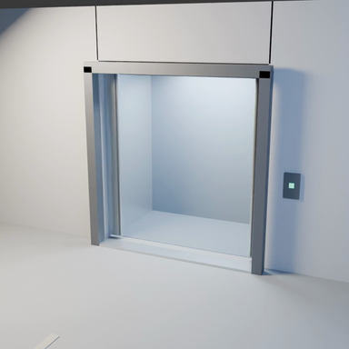
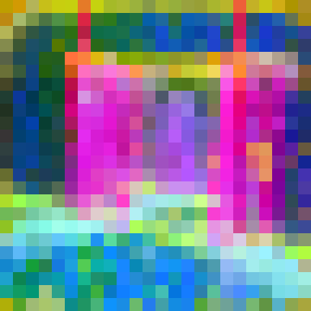
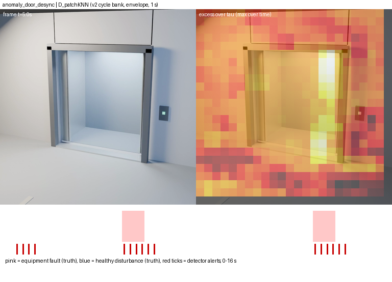
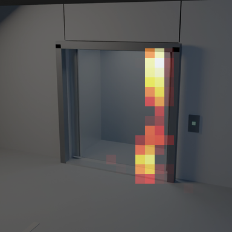
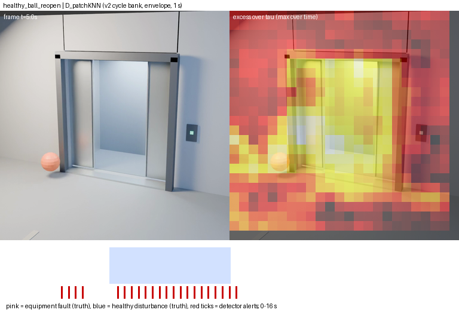
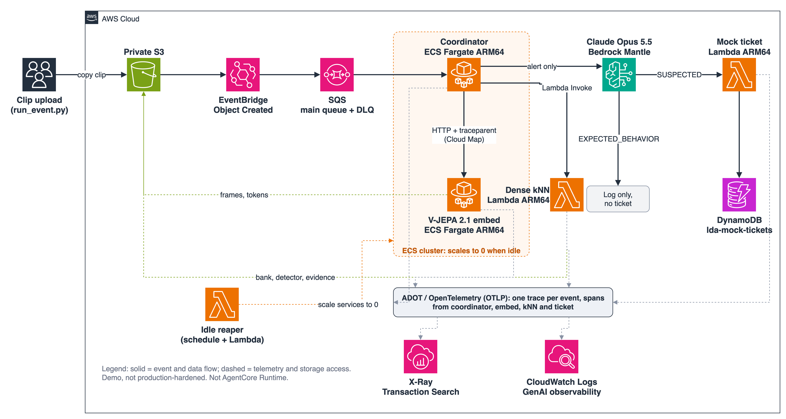
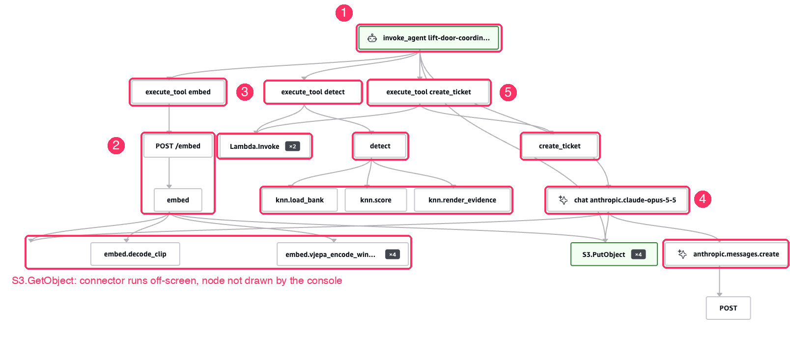

## Overview

Most factories, mines, utilities, transport hubs and warehouses already have cameras on the equipment that matters: lift doors, conveyors, pumps, gates, robot cells. They were usually bought for security, and almost nobody watches them for faults.

I have been testing whether a camera system can notice a fault that nobody wrote a rule for, and then tell a fault from a harmless surprise. Two obvious approaches fall short in my tests. A fixed rule only finds what someone listed. A frontier multimodal model watching every hour of video misses brief faults and costs a lot per camera-hour in tokens.

The pattern I tested sits between them. A cheap, always-on step learns what normal looks like from verified-healthy footage and says when and where a clip departs from it. Only the flagged window goes to the reasoner. The business value is using cameras you already paid for, with a gate that decides when to spend model tokens, so cost per camera-hour depends on how quiet the gate is.

What you will take away:

- How a frozen V-JEPA 2.1 encoder plus dense nearest-neighbour matching works as a learned-normal gate, with the real code.
- Why a reasoner (Claude Opus 5.5 on Amazon Bedrock) follows the gate, and how a small policy turns its answer into a ticket or a log entry.
- The agentic architecture on AWS: how one video event flows through it, how I observed it with OpenTelemetry in CloudWatch, and how I costed it.
- How to test the idea on your own footage, and the honest reasons it may not work.

> **Scope**
>
> All evidence is on simulated Blender footage: one lift-door scene, one camera, 12 clips (render seed 71), plus 302 more simulated clips in a fresh-seed follow-up. There is no real or customer footage and no customer data. Nothing here is a site result. Treat it as a worked example and a test plan.

> **Test status**
>
> - **Parity in two AWS accounts:** the same 4 clips gave the same answers in both (6 to 7 November 2026; 4/4 + 4/4, no errors, no re-runs). A parity test, not new accuracy.
> - **Unattended batch:** 48 clip runs (4 passes of 12) on 8 November for US$2.69 in total.
> - **Six extra full-flow events** (3 positive, 3 negative) on 9 November.
> - **Fresh-seed test:** 302 new simulated clips on 8 November, no healthy twins, strict false-alarm budget.
> - **Not done:** no real footage, no independent reproduction, not real time (68 s for a 16 s clip), not production-hardened, tickets are a mock DynamoDB table. I have not re-run the Reproduce steps from a clean checkout.

## Table of contents

- [Overview](#overview)
- [The gap: rules, and a frontier model on everything](#the-gap-rules-and-a-frontier-model-on-everything)
- [V-JEPA 2.1 in plain words](#v-jepa-21-in-plain-words)
- [Dense kNN as a learned-normal gate](#dense-knn-as-a-learned-normal-gate)
- [Why a reasoner follows the gate](#why-a-reasoner-follows-the-gate)
- [The architecture on AWS](#the-architecture-on-aws)
- [One event, traced end to end](#one-event-traced-end-to-end)
- [What I measured](#what-i-measured)
- [The economics](#the-economics)
- [Reproduce](#reproduce)
- [Limitations](#limitations)
- [References](#references)

## The gap: rules, and a frontier model on everything

Here is the fault I used throughout. In a simulated lift, the right door leaf starts closing out of step with the left for under a second, twice in a 16 s clip. Watch the right leaf at about 5 s.

<video controls muted loop playsinline preload="metadata" poster="/assets/videos/2026-11-10-Physical-AI-World-Model-Gate-Lift-Door/anomaly_door_desync.jpg" style="max-width:100%"><source src="/assets/videos/2026-11-10-Physical-AI-World-Model-Gate-Lift-Door/anomaly_door_desync.mp4" type="video/mp4">Your browser does not support the video tag.</video>

*Video 1. Simulated (Blender) door-desync clip, 16 s. The right leaf lags at 4.9 to 5.8 s and again at 12.9 to 13.8 s (generator ground truth).*



*Figure 1. One frame at 5.0 s from the clip above. It is easy to miss.*

In my 6-clip test (five fault clips, 10 fault events):

- **Fixed rules.** A door-asymmetry rule (A) found none of the 10 fault events and fired on a healthy clip. A cabin-brightness rule (B) found 4 of 10, all light flickers.
- **Claude Opus 5.5 on the whole clip** (32 frames at 2 frames per second) called all five faulty clips normal. With a healthy reference added it found 3 of 5 clips (4 of 10 fault intervals) but still missed plain door desynchronization. Watching every clip this way would cost US$11 to US$28 per camera-hour in tokens.

A brief fault inside long footage is a needle in a haystack, and cost grows with footage length. That is the gap the gate is meant to fill.

## V-JEPA 2.1 in plain words

V-JEPA is a family of self-supervised video models from Meta that learn from unlabelled video by predicting the features of hidden regions, not their pixels ([arXiv 2404.08471](https://arxiv.org/abs/2404.08471)). V-JEPA 2 adds V-JEPA 2-AC, which the paper describes as a latent action-conditioned world model ([arXiv 2506.09985](https://arxiv.org/abs/2506.09985)). V-JEPA 2.1 adds a dense predictive loss and deep self-supervision for better patch-level features ([arXiv 2603.14482](https://arxiv.org/abs/2603.14482)).

I use only the frozen V-JEPA 2.1 ViT-L encoder as a feature extractor. I do not use its predictor, forecast anything or train anything. The accurate description is "built on a world-model encoder", not "I built a world model".

For each 16 s clip, sampled at 4 frames per second and cropped to 384 x 384, the encoder returns one 24 x 24 grid of patch vectors (1,024 numbers each) per half-second step: 32 steps x 576 patches x 1,024 numbers.

From `agentic/lda_core/encoder.py` (lines 18 to 38 and 49 to 51; trimmed):

```python
def build_encoder(arch: str, ckpt: Path, img_size: int = 384, num_frames: int = 64):
    sys.path.insert(0, str(REPO))
    from app.vjepa_2_1.models import vision_transformer as vit_encoder

    enc = vit_encoder.__dict__[ARCH[arch]](
        patch_size=PATCH, img_size=(img_size, img_size), num_frames=num_frames,
        tubelet_size=TUBELET, use_sdpa=True,  # ...
    )
    sd = torch.load(ckpt, map_location="cpu", weights_only=False)
    if "ema_encoder" in sd:
        sd = sd["ema_encoder"]
    # ...
    enc.load_state_dict(sd, strict=True)
    return enc.eval()

# dense_tokens(enc, frames, device) returns tokens as [T/2, H/16, W/16, D] float32 (lines 42 to 46)

def encode_clip(enc, frames64: np.ndarray) -> np.ndarray:
    """Encode a 64-frame clip as four non-overlapping 16-frame windows."""
    return np.concatenate([dense_tokens(enc, frames64[s:s + 16], device="cpu") for s in range(0, 64, 16)], axis=0)
```



*Figure 2. V-JEPA 2.1 features for one step (5.0 to 5.5 s) of the simulated door-desync clip. Colours show the three strongest directions in the 1,024 numbers as red, green and blue. It is a display trick, not a prediction.*

## Dense kNN as a learned-normal gate

"Dense kNN" here means nearest-neighbour search (k = 1) done patch by patch. The logic:

1. **Build a bank of healthy cycles:** 5 verified-healthy clips from the same camera, two 8 s door cycles each, so 10 cycles of 16 steps.
2. **Compare like with like.** Each patch is compared with the patch at the same grid position and the same time in the door cycle in every bank cycle. The smallest distance (1 minus cosine similarity) is its novelty score.
3. **Set a per-position threshold, tau:** the largest distance any healthy cycle reaches when scored against the other bank clips (leave one clip out), plus 0.0001, per grid position and cycle time.
4. **Require persistence.** Scores are averaged over 2 x 2 neighbours (a 23 x 23 map per step). A step is flagged if any block exceeds tau; an alert needs 2 consecutive flagged steps (1 second).
5. **Output:** a heatmap of how far each block exceeds tau, alert times, the peak, and a 4 s window around it.

From `agentic/lda_core/detector.py` (lines 18 to 20 and 37 to 46):

```python
def patch_knn_map(test: np.ndarray, bank: list[np.ndarray]) -> np.ndarray:
    dists = [1.0 - np.einsum("thwd,thwd->thw", test, b, optimize=True) for b in bank]
    return blocks(np.min(dists, axis=0))


def build_envelope(bank_tokens: dict[str, np.ndarray]) -> np.ndarray:
    """Leave-one-clip-out max envelope across cycle-aligned block maps."""
    names = list(bank_tokens)
    loo = []
    for clip in names:
        for cycle in range(2):
            others = [cycles(bank_tokens[other])[cycle_idx] for other in names if other != clip
                      for cycle_idx in range(2)]
            loo.append(patch_knn_map(cycles(bank_tokens[clip])[cycle], others))
    return (np.max(loo, axis=0) + 1e-4).astype(np.float32)
```

The tokens are unit-normalised first, so the einsum is a cosine similarity. The decision itself, from `detect()` (lines 62 to 66):

```python
    tau = np.concatenate([envelope, envelope], axis=0)
    maps = np.concatenate([patch_knn_map(cyc, bank_cycles) for cyc in cycles(test)], axis=0)
    excess = (maps - tau).astype(np.float32)
    flags = persist((excess > 0).reshape(32, -1).any(axis=1))
```

`persist(flags, n=2)` (lines 27 to 34) marks a step only inside a run of at least `n` consecutive flagged steps.

Because any single block over tau flags a step, the gate is sensitive by design, and that has a cost (below).



*Figure 3. Door-desync clip (simulated). Left: the frame at the strongest alert. Right: warm blocks are above tau at their worst moment (colours scaled within this figure only). Bottom: pink bands are the real fault intervals; red ticks are alerts. Both faults are hit, with about four early false ticks.*



*Figure 4. Dense-kNN output for the 5.0 to 5.5 s step. 46 of 529 blocks are above the healthy limit, and they sit along the lagging right leaf.*

The gate needs no fault labels, only healthy examples, and it gives a where as well as a when. It assumes door cycles are aligned in time, so a real site needs cycle detection first. I did not build that.

## Why a reasoner follows the gate

The gate answers "is this unlike my healthy footage?". It cannot answer "is that a problem?". In one clip a ball rolls into the doorway as the doors close, and the doors reverse as designed. That is healthy, and the gate alerts on 22 of 64 samples. Watch the ball enter the doorway between about 3 and 7 s.

<video controls muted loop playsinline preload="metadata" poster="/assets/videos/2026-11-10-Physical-AI-World-Model-Gate-Lift-Door/healthy_ball_reopen.jpg" style="max-width:100%"><source src="/assets/videos/2026-11-10-Physical-AI-World-Model-Gate-Lift-Door/healthy_ball_reopen.mp4" type="video/mp4">Your browser does not support the video tag.</video>

*Video 2. Simulated healthy clip. A ball enters the doorway and the doors reopen by design. The gate flags it; the reasoner clears it.*



*Figure 5. Healthy ball-reopen clip (simulated). The gate alerts (red ticks), but there is no pink band because nothing is broken.*

The cabin-light flicker is the other fault type in the benchmark. Watch the cabin brightness around 13 s.

<video controls muted loop playsinline preload="metadata" poster="/assets/videos/2026-11-10-Physical-AI-World-Model-Gate-Lift-Door/anomaly_interior_light_flicker.jpg" style="max-width:100%"><source src="/assets/videos/2026-11-10-Physical-AI-World-Model-Gate-Lift-Door/anomaly_interior_light_flicker.mp4" type="video/mp4">Your browser does not support the video tag.</video>

*Video 3. Simulated cabin-light flicker clip. A cabin-brightness rule catches this one; a door rule does not.*

**What the reasoner receives.** `lda_core/evidence.py` (`build_evidence`, lines 27 to 50) picks a 16-frame, 4 s window around the peak, draws the detector map on the peak frame, and builds difference images as `4 * |current - reference|`. `lda_core/reasoner.py` (`build_request`, lines 60 to 105) sends the site context, the map, 4 difference images, 8 reference frames and the 16 flagged frames, each with an ID such as `CUR_03`, and requests structured output with `"output_config": {"format": {"type": "json_schema", "schema": SCHEMA}, "effort": "high"}`. The system prompt (lines 16 to 27) says the detector flagged a window as unlike normal, that "Novelty is not the same as a fault", and to answer `EXPECTED_BEHAVIOR` only if the model can point to a visible, benign cause.

The model must answer in a JSON schema with `classification` (the three values above), `observed_events`, `obstruction_visible`, `evidence_frame_ids`, `rationale` and `recommended_action`, among others. The coordinator calls it with the Anthropic SDK's Bedrock client (`AnthropicBedrockMantle(...).messages.create(**payload)`, `services/coordinator/main.py` lines 141 to 148), parses the JSON and validates it against the schema.

**The policy.** A small deterministic function turns the answer into an action (`lda_core/policy.py`, lines 5 to 50; trimmed):

```python
STRONG_SIGNAL = 2.0

def decide(detector: dict, reasoner_output: dict | None, reasoner_error: str | None = None) -> dict:
    if not detector.get("alert", False):
        return {"decision": "NO_ALERT_LOG_ONLY", ...}
    # ... validate the reasoner output; on failure classification stays "UNCERTAIN"
    if classification == "SUSPECTED_MALFUNCTION":
        return {"decision": "TICKET", "rule": "suspected_malfunction", ...}
    if classification == "EXPECTED_BEHAVIOR":
        evidence_ids = output.get("evidence_frame_ids", [])
        guard_passed = bool(
            output.get("obstruction_visible") is True
            and any(isinstance(item, str) and item.startswith("CUR_") for item in evidence_ids)
            and bool(output.get("observed_events"))
        )
        if guard_passed:
            return {"decision": "LOG_ONLY", "rule": "expected_behavior_visible_benign_cause", ...}
        classification = "UNCERTAIN"
    if classification == "UNCERTAIN":
        score = float(detector.get("max_score_over_tau", 0.0))
        if score >= STRONG_SIGNAL:
            return {"decision": "TICKET", "rule": "uncertain_strong_detector_signal", ...}
        return {"decision": "HUMAN_REVIEW", "rule": "uncertain_weak_detector_signal", ...}
```

An "expected behaviour" answer is only trusted if an obstruction is visible, the answer cites a flagged frame, and it names the observed events. Anything else is treated as uncertain, which becomes a ticket if the detector signal is at least 2 x tau and a human review if it is weaker. Note that a model failure also lands in `UNCERTAIN`, so an outage fails towards a ticket or a review, not towards silence.

**What it did.** Given the gate's evidence, Opus got all three flagged cases right: it logged the ball reopen as expected and flagged the door desync and the light flicker as suspected malfunctions. With frames only, it got one of three right (desync called expected, flicker uncertain). It is one case each, and the evidence and the prompt changed together between the two versions, so I cannot credit the gain to either. Swapping in the pixel detector's window and map, or a different reference clip, gave the same three verdicts, which suggests the reasoner relies mostly on the frames, the reference and the difference images, not on V-JEPA's map.

## The architecture on AWS



*Figure 6. The demo pipeline. It is a demo build, not production-hardened, and it does not use AgentCore Runtime.*

How one clip flows:

1. A clip lands under `incoming/` in a private **S3** bucket. S3 emits an `Object Created` event to **EventBridge**, and a rule sends it to an **SQS** queue with a dead-letter queue.
2. A **coordinator agent** on **ECS Fargate** takes the message and writes a claim object to S3 only if absent, so a redelivery is a no-op.
3. The coordinator calls the **embed service** (V-JEPA 2.1 on ECS Fargate, CPU only, ARM64) over HTTP. It decodes the clip and encodes four 16-frame windows.
4. The coordinator invokes the **dense-kNN Lambda**, which loads the healthy bank, scores the clip and renders the evidence.
5. Only if the gate alerts, the coordinator calls **Claude Opus 5.5 on Amazon Bedrock**.
6. The policy may call a **ticket Lambda** that writes a mock ticket to **DynamoDB**.
7. Every service emits **OpenTelemetry** spans, with a propagated trace context, to **X-Ray** and **CloudWatch GenAI Observability**.
8. An **idle reaper** Lambda scales the ECS services to zero when a time lease expires.

The wiring, from `agentic/infra/lda_infra/main_stack.py` (CDK, Python; lines 83 to 96 and 98 to 110; trimmed):

```python
self.queue = sqs.Queue(
    self, "DoorEventsQueue", queue_name="lda-door-events",
    visibility_timeout=Duration.seconds(1800),
    dead_letter_queue=sqs.DeadLetterQueue(max_receive_count=2, queue=sqs.Queue(
        self, "DoorEventsDlq", queue_name="lda-door-events-dlq", ...)),
)
events.Rule(
    self, "IncomingObjectCreatedRule", rule_name="lda-incoming-object-created",
    event_pattern=events.EventPattern(
        source=["aws.s3"], detail_type=["Object Created"],
        detail={"bucket": {"name": [self.data_bucket.bucket_name]},
                "object": {"key": [{"prefix": "incoming/"}]}},
    ),
    targets=[event_targets.SqsQueue(self.queue)],
)
```

The reaper is a Lambda on a 15-minute EventBridge schedule (`main_stack.py`, lines 483 to 488). It reads a lease timestamp from SSM Parameter Store (`/lda/lease_until`, lines 149 to 154). If the lease has not expired it does nothing; otherwise it calls `ecs.update_service(..., desiredCount=0)` for each service (`services/reaper/handler.py`). `demo_up.sh` sets the lease, so a forgotten demo stops itself.

The coordinator is a straight sequence, not a model-driven loop: embed, detect, and only on an alert the reasoner, then decide, then a ticket if the policy says so. From `services/coordinator/main.py` (lines 206 to 247, 253 and 291 to 293; trimmed):

```python
with _tool_span("embed") as span:
    ...
    response = requests.post(os.environ.get("LDA_EMBED_URL", "http://embed.lda.local:8080") + "/embed",
        json={"run_id": run_id, "clip_key": clip_key}, headers=inject_traceparent(), timeout=900)
with _tool_span("detect") as span:
    ...
    detector = detect_call(detect_event) if detect_call else _invoke_knn(detect_event)
if detector["alert"]:
    with TRACER.start_as_current_span("chat anthropic.claude-opus-5-5") as llm_span:
        ...
        output, detail = call(payload)
    decision_result = decide(detector, output, reasoner_result["error"])
else:
    decision_result = decide(detector, None)
```

## One event, traced end to end

**Span attributes.** I used the OpenTelemetry GenAI attribute names so CloudWatch GenAI Observability can read the trace, plus a few of my own under `lift.*`. From `services/coordinator/main.py` (lines 196 to 203; the Opus span at 262 to 289 adds `gen_ai.request.model`, token counts and `lift.classification`):

```python
set_genai_attrs(root, **{
    "gen_ai.operation.name": "invoke_agent",
    "gen_ai.agent.name": "lift-door-coordinator",
    "openinference.span.kind": "AGENT",
    "lift.run_id": run_id,
    "lift.clip_key": clip_key,
})
```

The run ID also travels as OpenTelemetry baggage and a span processor copies it onto every span (`telemetry.py` lines 86 to 93), so one clip is one trace across the Fargate services and the Lambdas.



*Figure 7. CloudWatch GenAI Observability trajectory for one simulated door-desync clip (annotated crop). 1: the agent run. 2: embed. 3: detect. 4: the Opus call. 5: the ticket. The console did not draw the S3.GetObject step.*

The numbers for that run, from the real console: **68 s** end to end for a 16 s clip, **29 spans**, 0 errors, **8,519 tokens**, **US$0.059**. In another run of the same clip the time split roughly as 34 s for embedding, 7.5 s for detection, 23 s for the Opus call and 7.3 s for the ticket. A healthy clip that does not alert takes a shorter path: 35 s, no model call, no ticket. The pipeline is not real time.

The 8 November batch ran 48 unattended clips for US$2.69 in total, with Opus verdicts unchanged across passes. One wrinkle: on a full-occlusion stress clip Opus said `EXPECTED_BEHAVIOR` but the clip still became a ticket in all four passes, apparently because the policy guard rejected the answer (inferred from the policy and the decision column; I did not open the per-clip result). Tune that kind of rule on your own site.

## What I measured

| What I tested | Result (simulated footage) |
|---|---|
| Fixed rules, 6-clip demo (10 fault events) | Rule A (door): 0 of 10. Rule B (light): 4 of 10, all flickers |
| Opus 5.5 on whole clips, frames only | 0 of 5 faulty clips; US$11 to 28 per camera-hour |
| Opus 5.5 plus healthy reference | 3 of 5 clips (4 of 10 intervals); US$19+ per camera-hour |
| Dense kNN gate, 6-clip demo | 10 of 10 fault events, but each fault's healthy twin was in the bank. False-alert samples per clip (of 64): 0 to 34 |
| Same, twin removed from the bank | Still 10 of 10, more false alerts on 4 of 5 clips |
| Pixel-patch kNN, 6-clip demo | Also 10 of 10, 0 false alerts on all five fault clips |
| Dense kNN, 302 fresh clips, no twins, 1 alert episode per camera-hour | **0 of 160** faults. Pixel baseline: 63 of 160 (62 of 64 flickers, 1 of 96 door desyncs) |
| Dense kNN, mild capture changes (exposure, 8 px shift, JPEG q30, noise), bank built on clean footage | Alerts on all 300 checks in 4 of 5 cases |
| Reasoner on the three flagged cases | 3 of 3 with gate evidence; 1 of 3 frames only (one case each) |

- **Open-set detection is not guaranteed coverage.** Ten events across five clips with twins in the bank is not an accuracy estimate. The fresh test had 160 fault events (96 door desyncs, 64 cabin flickers). My reading: timing variation in the healthy bank moves door positions about as much as the small desync lag does, and healthy disturbances in the calibration set pushed the threshold above the fault peaks.
- **A plain pixel detector matched or beat V-JEPA here.** Both failed the door-fault task on fresh seeds. In an earlier, separate pre-registered synthetic study (80 injected defects), pixel found 80 of 80 and V-JEPA 69 of 80. I make no claim that V-JEPA beats simpler detectors; the defensible distinction is rules versus learning normal.
- **The gate floods when capture conditions change.** Rebuilding the bank under the same condition fixed exposure and camera shift and mostly fixed noise, but JPEG still raised false alerts (about 150 of 300 checks).

## The economics

- **Embedding:** about US$0.006 per clip estimated. The 8 November batch measured US$0.0065 per clip of busy compute and about US$0.013 counting service uptime (the model loads for about 90 s, then waits between requests). At 225 clips per camera-hour, US$0.006 is about US$1.35.
- **Opus call:** about US$0.06 per alerted clip from live token counts (about 7,300 tokens in, 1,200 to 1,600 out); acceptance runs put it at about US$0.065.
- **Everything to Opus:** US$11.07 per camera-hour at 2 frames per second, US$27.76 at 4.

I used DoiT Attribute as the cost view. For this pipeline it showed the Fargate compute of the embed and coordinator workloads, not Bedrock or S3 lines, so I priced Bedrock from the traces. On a separate demo agent, 98% of three months of cost was always-on compute, not tokens, which is why the idle reaper exists.

The break-even is simple arithmetic. This snippet is mine, not from the repo, and it uses the measured costs above:

```python
CLIPS_PER_HOUR = 3600 / 16           # 225 clips of 16 s
OPUS_PER_WINDOW = 0.06               # US$ per flagged window
OPUS_ON_EVERYTHING = {"2 fps": 11.07, "4 fps": 27.76}   # US$ per camera-hour

for label, embed in (("estimate", 0.006), ("busy", 0.0065), ("uptime", 0.0133)):
    base = embed * CLIPS_PER_HOUR    # embed every clip, always
    for fps, full in OPUS_ON_EVERYTHING.items():
        print(f"{label:9s} {fps}: break-even {(full - base) / OPUS_PER_WINDOW:5.0f} flags/camera-hour")
```

Run as written, this prints about 162 and 440 flags per camera-hour for the US$0.006 estimate, 160 and 438 for the busy measurement, and 135 and 413 on an uptime basis. The headline is **about 160 flagged windows per camera-hour** against Opus at 2 frames per second.

| Flags per camera-hour | Gated cost per camera-hour | Versus Opus on everything |
|---|---|---|
| 2 (assumed) | about US$1.47 | 8 to 19 times cheaper (across the two Opus modes) |
| 160 | about US$11 | break-even at 2 fps |
| 375 (my healthy test clips) | about US$23.9 | more expensive |

The 2 is an assumption. The 375 is measured on unrepresentative clips: five of the six healthy clips contain a staged disturbance (ball, tree shadow, balloon) every 16 s. The one undisturbed clip alerted on 8 of 64 samples for V-JEPA and 0 for pixel, in 16 s only. So the saving is conditional on a gate calibrated on real footage, and I do not yet have a measured real alert rate. At 2 alerts per hour the embedding is about 92% of the gated bill, so the lease and reaper matter as much as the tokens.

## Reproduce

These are the real commands from `agentic/README.md` and `agentic/scripts/`. I have **not** re-run this sequence from a clean checkout. I ran the pieces during the build and the acceptance runs, so verify the order and the image-tag handling.

**Prerequisites.** An AWS account and CLI profile (the scripts use `us-east-1`); Bedrock access to Claude Opus 5.5; Meta's V-JEPA 2.1 ViT-L checkpoint, downloaded separately under its own licence (the embed service reads `LDA_CKPT_PATH`); healthy and test clips in a `lift_dataset/<split>/<scenario>/` layout; Python 3.11 and `uv`.

```bash
cd workshop/lift-door/agentic
# 1. local checks, no AWS
uv venv --python 3.11 .venv
uv pip install --python .venv/bin/python -r requirements-core.txt -r requirements-encoder.txt -r requirements-test.txt
.venv/bin/python -m pytest -q -m "not slow"

# 2. review the CDK diff, then deploy the build stack (deploy.sh refuses without a reviewed diff)
bash scripts/deploy.sh your-profile --diff-only --stacks build --diff-out /tmp/build-diff.txt
bash scripts/deploy.sh your-profile --deploy --stacks build --reviewed-diff /tmp/build-diff.txt

# 3. build images remotely; upload data and the checkpoint (drop --dry-run when the listing looks right)
bash scripts/remote_build.sh your-profile images
python3 scripts/upload_data.py --profile your-profile --data ../lift_scene/lift_dataset \
  --ckpt /path/to/vjepa2_1_vitl.pt --license /path/to/LICENSE --dry-run

# 4. deploy the main stack with the image tag and digests from the build
bash scripts/deploy.sh your-profile --diff-only --stacks main --diff-out /tmp/main-diff.txt -c imageTag=TAG -c imageDigests=PATH
bash scripts/deploy.sh your-profile --deploy --stacks main --reviewed-diff /tmp/main-diff.txt -c imageTag=TAG -c imageDigests=PATH

# 5. build the healthy bank as a one-off ECS task (bank-001 is an ID you choose)
bash scripts/cloud_build_bank.sh your-profile bank-001

# 6. services up with a 2-hour lease, one event, trace export, services down
bash scripts/demo_up.sh your-profile 2
python3 scripts/run_event.py --profile your-profile --scenario anomaly_door_desync
python3 scripts/export_trace.py --profile your-profile --run-id RUN_ID
bash scripts/demo_down.sh your-profile
```

`RUN_ID` is the ID `run_event.py` creates (`run-<timestamp>-<scenario>-<suffix>`). `export_trace.py` polls for up to 10 minutes because spans arrive late. `scripts/destroy.sh your-profile` removes the main stack and then the build stack; the data bucket and log groups are retained by design.

## Limitations

- **Simulated, narrow data:** one scene, one camera, one renderer; the fresh test used 302 clips from 28 seed families, all from the same generator.
- **Best case:** in the 6-clip demo each fault's healthy twin was in the bank and was the reasoner's reference.
- **Not shown better than a simple baseline,** and both found almost no door desyncs on fresh seeds.
- **The reasoner result is thin:** three cases, evidence and prompt changed together.
- **Brittle to capture changes** unless the bank is rebuilt under the same conditions; JPEG stayed a problem even then.
- **Needs aligned cycles.** A real lift needs cycle detection first; a 1.0 s phase error brought both detectors close to chance.
- **Not real time, mock tickets, demo build.**
- **Cost saving is conditional:** break-even is about 160 flags per camera-hour; my healthy test clips fired 375, and the real rate is unknown.
- **No reproduction by anyone else, and no clean-checkout re-run of the Reproduce steps.**

**What to test on your own site.** Write the pass bar first for one asset, one fault type and one camera. Build the bank from footage a person has verified, with separate calibration and test sets. Set a false-alarm budget your team can handle and measure the real alert rate before cost modelling. Add a cycle trigger. Test without healthy twins. Compare against a pixel detector under the same budget. Re-baseline when exposure, camera position or compression changes. Keep a human on `UNCERTAIN`. If the gate catches too little at a budget you can live with, the pattern does not work for that fault, and that is a useful result.

## References

- Bardes et al., [Revisiting Feature Prediction for Learning Visual Representations from Video (V-JEPA)](https://arxiv.org/abs/2404.08471), arXiv 2404.08471.
- Assran et al., [V-JEPA 2: Self-Supervised Video Models Enable Understanding, Prediction and Planning](https://arxiv.org/abs/2506.09985), arXiv 2506.09985.
- Mur-Labadia et al., [V-JEPA 2.1: Unlocking Dense Features in Video Self-Supervised Learning](https://arxiv.org/abs/2603.14482), arXiv 2603.14482.
- [Amazon EventBridge: events from Amazon S3](https://docs.aws.amazon.com/AmazonS3/latest/userguide/EventBridge.html)
- [Amazon SQS dead-letter queues](https://docs.aws.amazon.com/AWSSimpleQueueService/latest/SQSDeveloperGuide/sqs-dead-letter-queues.html)
- [Amazon Bedrock documentation](https://docs.aws.amazon.com/bedrock/latest/userguide/what-is-bedrock.html)
- [Amazon CloudWatch generative AI observability](https://docs.aws.amazon.com/AmazonCloudWatch/latest/monitoring/GenAI-observability.html)
- [AWS Distro for OpenTelemetry](https://aws-otel.github.io/) (its page now suggests the CloudWatch agent or an OpenTelemetry Collector for new CloudWatch setups; my demo uses the ADOT exporter)
- [OpenTelemetry GenAI semantic conventions](https://github.com/open-telemetry/semantic-conventions-genai) (moved from opentelemetry.io; the page there now redirects)
- Repository paths used in this post: `agentic/lda_core/`, `agentic/services/`, `agentic/infra/lda_infra/main_stack.py`, `agentic/scripts/`, `agentic_batch_8nov/` and `research/arxiv_gap/followup_9nov/{a,b,c}/RESULTS.md`.
